# 📊 Dataset — Respiratory Sound Preparation Pipeline

This folder contains the **data preparation pipeline** for the **EILO-BioAcoustics-Analysis** project. It transforms the raw [SPRSound](https://github.com/SJTU-YONGFU-RESEARCH-GRP/SPRSound) dataset of pediatric respiratory sound recordings into clean, fragment-level audio and time–frequency representations ready for modeling.

The pipeline is implemented as **6 ordered, independent scripts** that build on each other's outputs.

---

## Table of Contents

- [📂 Repository layout](#-repository-layout)
- [⚙️ Quickstart (full pipeline)](#️-quickstart-full-pipeline)
- [🔁 Pipeline overview](#-pipeline-overview)
    - [1️⃣ Extract the raw SPRSound records — get_sprsound_dataset.py](#1️⃣-extract-the-raw-sprsound-records--get_sprsound_datasetpy)
    - [2️⃣ Build the metadata table — get_metadata.py](#2️⃣-build-the-metadata-table--get_metadatapy)
    - [3️⃣ Split records by quality — get_poor_quality_records.py](#3️⃣-split-records-by-quality--get_poor_quality_recordspy)
    - [4️⃣ Extract annotated respiratory fragments — get_fragments.py](#4️⃣-extract-annotated-respiratory-fragments--get_fragmentspy)
    - [5️⃣ Compute time–frequency representations — get_rtf.py]()
        - [Fragment pre-processing (pre_process)](#fragment-pre-processing-pre_process)
        - [⚙️ RTF configurarion](#rtf-configurarion-see-calculate_rtf)
    - [6️⃣ Filter fragments by label and duration — filter_dataset.py](#6️⃣-filter-fragments-by-label-and-duration--filter_datasetpy)
- [📁 Final folder layout](#-final-folder-layout)
- [📓 Notebooks](#-notebooks)
    - [▶️ How to run](#-how-to-run)
    - [visualization_signal.ipynb — Raw record + preprocessing](#visualizationsignalipynb--raw-record--preprocessing)
    - [visualization_fragment.ipynb — Single fragment + STFT](#visualizationfragmentipynb--single-fragment--stft)
    - [EDA.ipynb — Exploratory Data Analysis](#edaipynb--exploratory-data-analysis)
        - [📝 Results](#-results)
    - [EDA_filtered.ipynb — Exploratory Data Analysis (crackle-filtered)](#eda_filteredipynb--exploratory-data-analysis-crackle-filtered)
        - [📝 Results](#-results-1)
    - [denoise_soundwaveletSWT.ipynb — Transient removal filter](#denoise_soundwaveletswtipynb--transient-removal-filter)

---

## 📂 Repository layout

When you clone the repository, the `dataset/` folder ships with the pipeline scripts and four exploratory notebooks — but no data. After running the full pipeline, see [📂 Final folder layout](#-final-folder-layout) for what ends up in this directory.

```
dataset/
├── assets/                      ← folder with the images in this file
├── README.md                    ← this file
├── get_sprsound_dataset.py      ← step 1
├── get_metadata.py              ← step 2
├── get_poor_quality_records.py  ← step 3
├── get_fragments.py             ← step 4
├── get_rtf.py                   ← step 5
├── filter_dataset.py            ← step 6
├── src/
│   ├── calculate_rtf.py         ← RTF functions used by get_rtf.py
│   └── remove_heart_sounds.py   ← transient removal used by get_rtf.py (previous version, see step 5)
├── EDA.ipynb                    ← exploratory analysis of fragments_metadata.csv
├── EDA_filtered.ipynb           ← exploratory analysis of fragments_metadata_filtered.csv
├── visualization_signal.ipynb   ← raw record + preprocessing visualization
└── visualization_fragment.ipynb ← single-fragment pre-processing + STFT visualization
```

The development of the transient removal filter (`denoise_soundwaveletSWT.ipynb` and its evaluation) lives in [`denoising/`](../denoising/).

---

## ⚙️ Quickstart (full pipeline)

From the project root:

```bash
# 0. Clone SPRSound (one-time)
git clone https://github.com/SJTU-YONGFU-RESEARCH-GRP/SPRSound.git

# 1–6. Run the pipeline in order
python dataset/get_sprsound_dataset.py
python dataset/get_metadata.py
python dataset/get_poor_quality_records.py
python dataset/get_fragments.py
python dataset/get_rtf.py -t STFT
python dataset/filter_dataset.py
```

The resulting `dataset/dataset/spectrogram/*.tiff` files together with `dataset/fragments_metadata.csv` (or, with crackle fragments and too short / too long fragments removed, `dataset/fragments_metadata_filtered.csv`) are the canonical input for downstream training.

---

## 🔁 Pipeline overview

| Step | Script | Input | Output |
|:----:|:-------|:------|:-------|
| **1/6** | `get_sprsound_dataset.py` | `../SPRSound/` (cloned repo) | `full_dataset/wav/`, `full_dataset/json/` |
| **2/6** | `get_metadata.py` | `full_dataset/wav/`, `full_dataset/json/` | `metadata.csv` |
| **3/6** | `get_poor_quality_records.py` | `full_dataset/`, `metadata.csv` | `good_quality/`, `poor_quality/` |
| **4/6** | `get_fragments.py` | `good_quality/` | `dataset/audio/`, `fragments_metadata.csv` |
| **5/6** | `get_rtf.py` | `dataset/audio/`, `fragments_metadata.csv` | `dataset/{stft,scalogram,wsst}/*.tiff` |
| **6/6** | `filter_dataset.py` | `fragments_metadata.csv` | `fragments_metadata_filtered.csv` |

Each step depends on the outputs of the previous ones, so they must be run in order. Step 6 is a fork rather than a continuation: it does not feed step 5, it filters the same `fragments_metadata.csv` that step 4 produces, in parallel to it.

> Because step 6 only depends on step 4's output (`fragments_metadata.csv`), it can be run right after step 4 — before step 5 — if you only need the filtered fragment list and not the spectrograms yet, or if you want the RTF of the filtered dataset, directly.

---

### 1️⃣ Extract the raw SPRSound records — [get_sprsound_dataset.py](get_sprsound_dataset.py)

Collects all `.wav` and `.json` files from the four SPRSound sub-repositories (BioCAS2022, BioCAS2023, BioCAS2024, BioCAS2025) and copies them into a single flat structure.

**Requires:** a clone of the SPRSound repository at `../SPRSound/`
```bash
git clone https://github.com/SJTU-YONGFU-RESEARCH-GRP/SPRSound.git
```

**Generates:**
```
dataset/
├── full_dataset/
│   ├── wav/   # {patient}_{age}_{gender}_{position}_{record_id}.wav
│   └── json/  # {patient}_{age}_{gender}_{position}_{record_id}.json
```

**Run:**
```bash
python dataset/get_sprsound_dataset.py
```

---

### 2️⃣ Build the metadata table — [get_metadata.py](get_metadata.py)

Walks every `.json` annotation file and produces a single `metadata.csv` describing each record.

**Per-record fields:**

| Field | Description |
|:------|:------------|
| `record_id` | SPRSound record id |
| `patient_id` | SPRSound patient id |
| `age` | Patient's age |
| `gender` | `"0"` = male, `"1"` = female |
| `position` | Recording position (e.g. chest, back, neck) |
| `json_path` | Relative path to the `.json` annotation |
| `wav_path` | Relative path to the `.wav` file |
| `Poor Quality` | `1` if SPRSound flags the record as *Poor Quality*, else `0` |

**Run:**
```bash
python dataset/get_metadata.py
```

**Generates:** `dataset/metadata.csv`

---

### 3️⃣ Split records by quality — [get_poor_quality_records.py](get_poor_quality_records.py)

Reads `metadata.csv` and copies each record into one of two folders based on SPRSound's `record_annotation` flag.

**Generates:**
```
dataset/
├── good_quality/
│   ├── wav/
│   └── json/
└── poor_quality/
    ├── wav/
    └── json/
```

Only `good_quality/` records are used downstream for fragment extraction.

**Run:**
```bash
python dataset/get_poor_quality_records.py
```

---

### 4️⃣ Extract annotated respiratory fragments — [get_fragments.py](get_fragments.py)

For every `good_quality` record, this script:

1. Loads the `.wav` signal and the event annotations from the `.json`.
2. **Pre-processes** the signal:
   - 8th-order Butterworth **bandpass filter** at **70–1900 Hz**
   - **Resamples** from 8 kHz to 4 kHz
3. Crops the signal at each event's `[start, end]` timestamp.
4. Renames each fragment to a sequential id (`1.wav`, `2.wav`, …).
5. Builds a `fragments_metadata.csv` with per-fragment labels and patient info.

**Per-fragment fields:**

| Field | Description |
|:------|:------------|
| `id` | Sequential fragment id (matches the `.wav` filename) |
| `name` | Anonymized patient id (`P1`, `P2`, …) |
| `age` | Patient's age |
| `gender` | `"0"` = male, `"1"` = female |
| `position` | Recording position |
| `record_id` | SPRSound source record id |
| `segment` | Index of this segment within its record (0-based) |
| `label` | One of: `Normal`, `Rhonchi`, `Wheeze`, `Stridor`, `Coarse Crackle`, `Fine Crackle`, `Wheeze+Crackle` |
| `category` | `"Normal"` if `label == "Normal"`, else `"Adventitious"` |
| `duration` | Fragment duration in seconds |

**Generates:**
```
dataset/dataset/
├── audio/                       # {id}.wav  (resampled, filtered fragments)
└── fragments_metadata.csv
```

**Run:**
```bash
python dataset/get_fragments.py
```

---

### 5️⃣ Compute time–frequency representations — [get_rtf.py](get_rtf.py)

For each fragment `.wav`, this step first **pre-processes** the signal (transient removal and normalization to a fixed 2-second duration), then computes a **time–frequency representation (RTFs)** and stores each as a 224×224 `.tiff` image suitable for CNN-based models. Each RTF is written to its own subfolder so they can be used independently for ablations or multi-view training.

#### Fragment pre-processing (`pre_process`)

**1. Transient removal** (see [denoise_soundwaveletSWT.ipynb](#denoise_soundwaveletswtipynb--transient-removal-filter)): some fragments contain **clicks, crackles and other short broadband transients** (impulsive noise, e.g. stethoscope friction or saturation of the original recording) loud enough to mask the respiratory sound, or to fake one. The goal of this step is to attenuate those transients **without damaging the respiratory, adventitious or heart sounds** (heart sounds are not a target: they are present in every class, `Normal` included). The filter is a modification of `soundwaveletSWT`, an adaptive wavelet filter originally designed to attenuate heart sounds (inspired by [Zhan et al., 2010](https://doi.org/10.1016/j.jelekin.2009.07.007)):

1. **Decomposition:** the signal is decomposed with the **Stationary Wavelet Transform** (SWT, `db4`) until the approximation is below ~15 Hz (7 detail levels at 4 kHz, one octave each). Levels 3, 4 and 5 (62–500 Hz) are split into 2 half-bands each with one more SWT step on the detail coefficients, using the filters dilated to that level (*stationary wavelet packet*). This gives **10 bands**: 1000–2000 · 500–1000 · 375–500 · 250–375 · 188–250 · 125–188 · 94–125 · 62–94 · 31–62 · 16–31 Hz. The split is a tight frame, so it is inverted exactly (with its adjoint, via FFT) before the inverse SWT.
2. **Detection per band:** the **envelope** of each band (smoothed Hilbert magnitude) is compared with a **local reference**: the median of the envelope between 0.1 and 0.4 s at each side of every sample (the central ±0.1 s are excluded so the event itself does not raise its own reference). Where the envelope exceeds **K = 8** times the reference, an event is detected (mask widened 10 ms at each side).
3. **Long-event protection:** detected events longer than **120 ms** (`MAX_EVENT`) in a band are respiratory or adventitious sounds (clicks, crackles and S1/S2 are shorter), so they are kept. The protection only applies to the band where the long event is detected (`PROTECT_LEVELS = 0`): in the low bands the long SWT filters merge close, short impulses into a single "long" event, and protecting it in all bands kept those impulses everywhere.
4. **Classification of the candidates:** each time span with detections left (union over bands) is a candidate. For each one, four features are measured:
    - **Bands and intensity:** number of bands with a detection, and median / maximum over the bands of the peak envelope / reference ratio.
    - **Peak width:** time around the maximum of each band's envelope within **20 dB** of it. Unlike the time above the threshold, it does not grow with the intensity of the event (a very strong click takes long to fall below the threshold, but its peak is still narrow).
    - **Impulsiveness `z`:** |prediction error| / local robust scale, with a robust AR(20) model of the signal (Huber IRLS; AR click detector of Godsill, Rayner & Cappé, 1997, *Digital Audio Restoration*, §3.2.1). Not computed on saturated samples.
    - **Isolation:** peak of the full-band envelope / background **before and after** the event (median over 0.1 s on each side; the stronger side is used). The onset of a wheeze or a stridor only stands out over what comes before it; a click or a crackle stands out over both sides.

    A candidate is a transient (to be removed) if it meets any of these rules:

    | Rule | Bands | Intensity (envelope / reference) | Peak width | Other |
    |:-----|:-----:|:---------:|:----------:|:------|
    | **Broadband click** | ≥ 6 | median ≥ 12 | median ≤ 65 ms | — |
    | **Impulsive click** (few bands, e.g. only the high ones) | — | > 30 in a band ≥ 500 Hz | median ≤ 100 ms | `z` > 30, isolation ≥ 5 |
    | **Isolated transient** (e.g. a crackle, even in a single band) | — | max ≥ 12 | max ≤ 45 ms | isolation ≥ 10 |

    Candidates closer than 10 ms to the fragment borders only count if also `z` > 12, since their real duration is unknown (e.g. an adventitious sound cut by the annotation). All the other detections (heart sounds, bursts of adventitious sounds, …) are discarded, i.e. kept in the signal.
5. **Attenuation:** inside each transient (±20 ms, since each `db4` band has a different delay), the reference is the **immediate background** (median envelope in the 50 ms before and after, if lower than the 0.1–0.4 s reference, which can include a nearby loud sound), and **every band** that stands out **3 times** over it is attenuated, not only the bands detected with `K`. The envelope is brought down to **1.5 times** the reference (background level), with a smoothed gain to avoid new clicks.
6. **Reconstruction:** the split levels are merged back and the signal is reconstructed with the detail levels only (the < 15 Hz component is removed).

| Parameter | Value | Role |
|:----------|:------|:-----|
| `K` | 8 | Detection threshold (times the local reference) |
| `G_FAC` | 1.5 | Attenuation level (times the reference) |
| `REF_INNER` / `REF_OUTER` | 0.1 / 0.4 s | Local reference window at each side of the sample |
| `REF_STEP` | 5 ms | The reference is computed every 5 ms and linearly interpolated (×17 faster, negligible difference); `None` → exact, at every sample |
| `SPLIT_LEVELS` | [3, 4, 5] | SWT levels split into 2 half-bands; `None` → no split (7 bands) |
| `MAX_EVENT` | 0.12 s | Events longer than this are protected (respiratory/adventitious sounds); `None` → no protection |
| `PROTECT_LEVELS` | 0 | A long event in band *l* protects bands *l* ± `PROTECT_LEVELS`; `None` → all bands |
| `CLICK_ONLY` | `True` | Only the candidates classified as transients are attenuated; `False` → every detected event (original behavior, which also removes heart sounds) |
| `MIN_BANDS` / `R_MED` / `MAX_WIDTH` | 6 / 12 / 65 ms | Broadband click rule |
| `Z_CLICK` / `R_CLICK` / `F_CLICK` / `MAX_WIDTH_IMPULSIVE` / `ISOLATION_IMPULSIVE` | 30 / 30 / 500 Hz / 100 ms / 5 | Impulsive click rule |
| `R_TRANSIENT` / `MAX_WIDTH_TRANSIENT` / `ISOLATION` / `ISO_WIN` | 12 / 45 ms / 10 / 0.1 s | Isolated transient rule |
| `EDGE_CLICK` / `Z_EDGE` | 10 ms / 12 | Candidates at the fragment borders also need `z` > `Z_EDGE` |
| `K_ATTENUATE` / `SPAN_MARGIN` / `LOCAL_BG` | 3 / 20 ms / 50 ms | Attenuation inside a transient |
| `AR_ORDER` / `Z_WIN` | 20 / 0.1 s | AR model and local scale of the impulsiveness score |

> No single feature works alone: after the 70–1900 Hz band-pass filter many clear clicks have `z` = 5–8, like wheeze bursts, and bursts of wheeze, stridor and rhonchi are also broadband, but have peak widths of 78–190 ms or a median intensity ≤ 12.

> **Known limitations:** a click inside a long sound (e.g. within a stridor) is protected, and weak crackles or clicks (< ~12× their band background, or not isolated) are missed.

> ⚠️ The new algorithm is developed in [denoise_soundwaveletSWT.ipynb](#denoise_soundwaveletswtipynb--transient-removal-filter) and is **not yet ported to the pipeline**: `src/remove_heart_sounds.py` (used by `get_rtf.py`) and `visualization_fragment.ipynb` still implement the previous version (every detected event attenuated, `K = 5`, `MAX_EVENT = 0.12 s`).

**2. Duration normalization:** fragment durations vary (see [EDA results](#-results)), but RTFs need a fixed-length input, so every fragment is brought to a fixed **2-second** window (`SEGMENT_DURATION`) before the RTF is computed:

- **Duration < 2 s → cyclic padding:** the signal is tiled end-to-end enough times to exceed 2 s, then a random 2-second window is cropped from the tiled signal (wrapping around cyclically). This avoids the discontinuities of zero-padding and avoids always exposing the same phase of the fragment to the model. The random window is seeded per fragment (`SEED + fragment id`), so the output is reproducible regardless of the processing order.
- **Duration ≥ 2 s → most-energetic window:** the signal is passed through an energy filter (`signal²` convolved with a 2-second moving-sum kernel) and the 2-second window with the highest cumulative energy is selected, on the assumption that this window best captures the annotated event rather than surrounding silence/background.
- **Normalization:** in both cases, the resulting 2-second segment is z-score normalized (subtract mean, divide by standard deviation) before being handed to `calculate_rtf`.

> In the filtered dataset (0.5–3 s, see [EDA_filtered results](#-results-1)) the median fragment lasts 1.68 s, so with a 2-second window 68.2% of the fragments are cyclically padded (`Normal` 67.4%, `Wheeze` 78.8%, `Rhonchi` 59.1%, `Stridor` 62.5%) and the rest are cropped to their most energetic 2 seconds.

**Available RTFs:**

| RTF | Status | Library | Description |
|:----|:------:|:--------|:------------|
| `STFT` | ✅ implemented | `scipy.signal.ShortTimeFFT` | Log-frequency, dB-scale spectrogram (see config below) |
| `SCALOGRAM` | 🟡 planned |  |  |
| `WSST` | 🟡 planned |  |  |

> All RTFs share the same output contract: 224×224 float32 array written as `.tiff`. 

#### RTF configurarion (see [calculate_rtf](src/calculate_rtf.py)):

**STFT configuration**

| Parameter | Value |
|:----------|:------|
| Window | Hann, **400 samples** (100 ms at 4 kHz) |
| Hop size | **10 samples** |
| FFT length | **2048** points |
| Frequency range | **50–1050 Hz** (cropped) |
| Frequency scale | **Logarithmic** (`np.geomspace`) |
| Amplitude scale | **Decibels** (`10·log10`), normalized so the spectrogram's peak is **0 dB** before conversion |
| Output size | **224 × 224** pixels (resized, vertically flipped) |

> The spectrogram is normalized to its own maximum (`spectrogram / spectrogram.max()`) before the dB conversion, so amplitude is expressed relative to each fragment's peak energy rather than on an absolute scale. 

**Run (one RTF at a time):**
```bash
python dataset/get_rtf.py -t STFT
# python dataset/get_rtf.py -t SCALOGRAM   # once implemented
# python dataset/get_rtf.py -t WSST        # once implemented
```

**Generates:**
```
dataset/dataset/
├── spectrogram/        # STFT
│   └── {id}.tiff
├── scalogram/          # CWT (planned)
│   └── {id}.tiff
└── wsst/               # Wavelet Synchrosqueezed STFT (planned)
    └── {id}.tiff
```

> Fragments are processed in parallel with `multiprocessing` (one worker process per CPU core), since each fragment is independent and the cost is dominated by the RTF computation.

> The `-t` flag selects the representation.
> New RTFs can be added by implementing a `calculate_<name>(signal, fs)` function in `src/calculate_rtf.py` and registering it in the `CALCULATE_RTF` dict.
> The rest of the pipeline (folder creation, `.tiff` export, resize) is handled generically.

---

### 6️⃣ Filter fragments by label and duration — [filter_dataset.py](filter_dataset.py)

Reads `fragments_metadata.csv` and writes a filtered copy, applying two filters in order:

**1. Label filter** — crackle-related fragments are removed:

- Drops `Fine Crackle` and `Coarse Crackle` fragments entirely.
- Collapses `Wheeze+Crackle` into `Wheeze` (keeps the wheeze component, discards the crackle component).
- Leaves all other labels unchanged.

**2. Duration filter** — only the fragments with `D_MIN <= duration <= D_MAX` (inclusive) are kept, with `D_MIN = 0.5 s` and `D_MAX = 3.0 s` (`duration_mask`; a threshold set to `None` is not applied).

> Only depends on step 4, so it can be run right after `get_fragments.py` — before `get_rtf.py` (step 5) — if you don't need the spectrograms yet.

Crackles are filtered out because they are **not relevant to this project**: EILO (Exercise-Induced Laryngeal Obstruction) is an upper-airway, inspiratory condition that presents acoustically as wheeze/stridor, not as the fine/coarse crackles typically associated with lower-airway pathology (e.g. fluid or fibrosis in the alveoli). Crackles are also **uncommon in the patient population this project will study**, so keeping them in the training data would bias models toward a class they are unlikely to encounter in practice.

**Label mapping:**

| Original label | Filtered label |
|:----------------|:----------------|
| `Fine Crackle` | *(dropped)* |
| `Coarse Crackle` | *(dropped)* |
| `Wheeze+Crackle` | `Wheeze` |
| Normal / Wheeze / Rhonchi / Stridor | unchanged |

**Generates:** `dataset/fragments_metadata_filtered.csv`

**Run:**
```bash
python dataset/filter_dataset.py
```

See [EDA_filtered.ipynb](#eda_filteredipynb--exploratory-data-analysis-crackle-filtered) for exploratory analysis of the resulting dataset.

---

## 📁 Final folder layout

After running the full pipeline, the relevant outputs are (compare with
[📂 Repository layout](#-repository-layout) to see what ships with the repo vs. what the pipeline produces):

```
dataset/
├── full_dataset/          ← step 1
│   ├── wav/                       
│   └── json/                        
├── good_quality/          ← step 3
│   ├── wav/                       
│   └── json/                        
├── poor_quality/          ← step 3
│   ├── wav/                       
│   └── json/                        
├── dataset/               ← steps 4 & 5
│   ├── audio/             # filtered, resampled fragments
│   ├── spectrogram/       # 224×224 STFT .tiff images
│   ├── scalogram/         # 224×224 CWT .tiff images (planned)
│   └── wsst/              # 224×224 WSST .tiff images (planned)
├── metadata.csv                    ← step 2
├── fragments_metadata.csv          ← step 4
└── fragments_metadata_filtered.csv ← step 6
```

---

## 📓 Notebooks

The dataset ships with four exploratory / visualization notebooks alongside the pipeline scripts (see [📂 Repository layout](#-repository-layout)). They are **read-only documentation and exploration** — running them does not modify the pipeline outputs. 

### ▶️ How to run

From the `dataset/` folder, launch Jupyter / VS Code and open the notebook of interest, then run all cells in order.

### [visualization_signal.ipynb](visualization_signal.ipynb) — Raw record + preprocessing

Visualizes one full record end-to-end: loads a `.wav` and its companion `.json` from `good_quality/`, applies the pipeline's preprocessing, and plots the time-domain signal (with event annotations) and the PSD before vs. after preprocessing. Useful for sanity-checking the filter and resampling steps on a single record.

### [visualization_fragment.ipynb](visualization_fragment.ipynb) — Single fragment + STFT

Visualizes a single fragment from `dataset/audio/` through the whole `pre_process` of step 5: plots the raw waveform, the [transient removal](#fragment-pre-processing-pre_process) (still the previous version of the filter; original vs. filtered signal, removed component and the band-by-band SWT decomposition with envelopes, thresholds and gains), the duration normalization (cyclic padding or most-energetic window) and standardization, and finally the STFT spectrogram that the pipeline writes to `spectrogram/<id>.tiff`, both as an interactive heatmap and as the final 224×224 preview.

### [EDA.ipynb](EDA.ipynb) — Exploratory Data Analysis

Exploratory analysis of the prepared fragment dataset using `fragments_metadata.csv`. The notebook examines the following aspects of the dataset:
- some **descriptiive parameters** of the dataset,
- the **distribution of respiratory-sound labels**,
- the **age patient distribution** (patient level, fragment level and label level),
- fragment **durations** (fragment level and label level),
- the **number of fragments** contributed by each **record**,
- the **number of records** contributed by each **patient**,
- the **number of fragments** contributed by each **patient**,
- the **number of distinct labels** observed per patient,
- and the **relationship between age and duration** (by label).

Each section includes visualizations and descriptive statistics to characterize the dataset and identify relevant patterns.

#### 📝 Results

- **Descriptive parameters**:
    - Number of records: 6567
    - Number of `Poor Quality` records: 230 (3.5%)
    - Number of segments: 24578
    - Number of patients: 958
    - Total recorded time: 20h 48 min 39.85 s
    - Corpus duration: 11 h 52 min 39.24 s (57.07%)
<br/><br/>

- **Label distribution:**
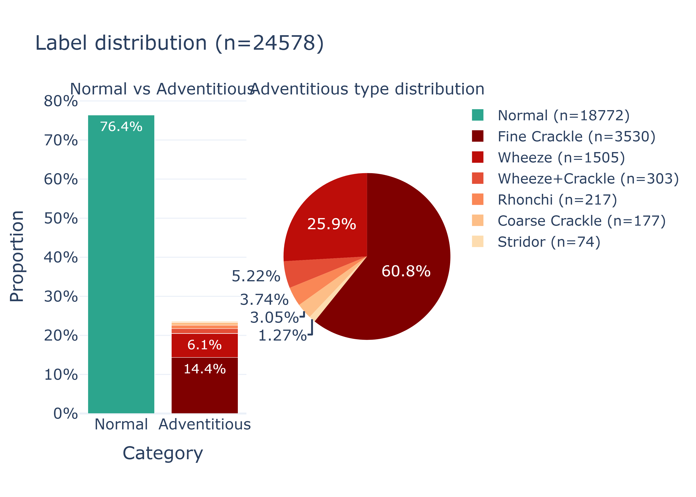

|     Category     | Proportion | Relative fraction |
|:----------------:|:----------:|:----------:|
| **Normal**       |            |            |
|      Normal      |    76.4%   |    100%    |
| **Adventitious** |            |            |
|   Fine Crackle   |    14.4%   |    60.8%   |
|      Wheeze      |    6.1%    |    25.9%   |
|  Wheeze+Crackle  |    1.2%    |    5.22%   |
|      Rhonchi     |    0.9%    |    3.74%   |
|  Coarse Crackle  |    0.7%    |    3.05%   |
|      Stridor     |    0.3%    |    1.27%   |

- **Age distribution:**


| Metric | Age (years) |
|:------:|:-----------:|
|  Mean  |     5.54    |
|   std  |     3.60    |
|   min  |       0     |
|   Q1   |     3.4     |
| Median |     5       |
|   Q3   |     7.3     |
|   max  |      55     |

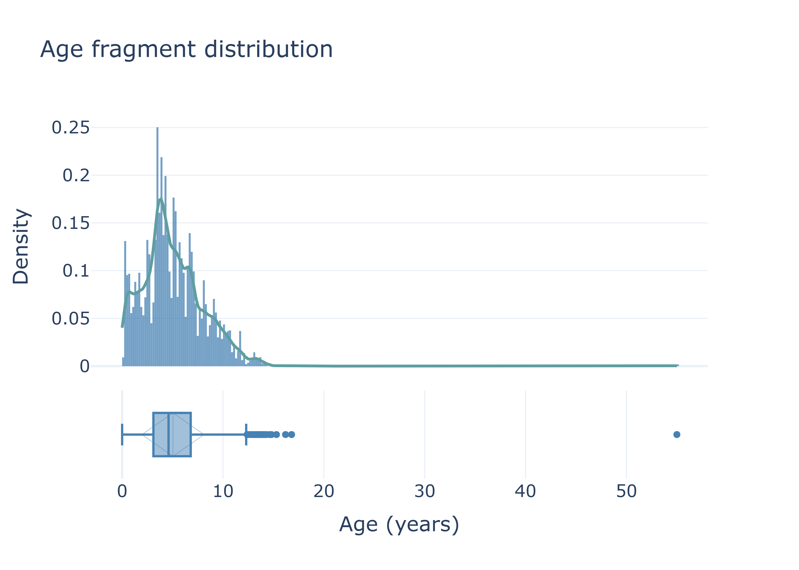

| Metric | Age (years) |
|:------:|:-----------:|
|  Mean  |     5.04    |
|   std  |     3.08    |
|   min  |       0     |
|   Q1   |     3.1     |
| Median |     4.6     |
|   Q3   |     6.8     |
|   max  |      55     |

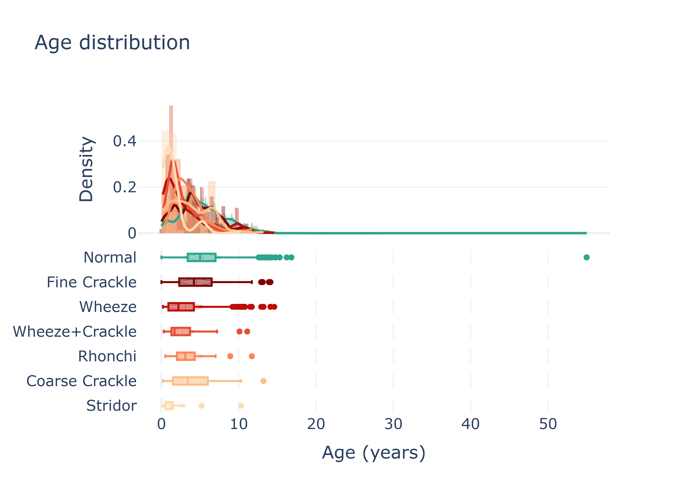

| **Metric / Age (years)** | Normal | Fine Crackle | Wheeze | Wheeze+Crackle | Rhonchi | Coarse Crackle | Stridor |
|:------------------------:|:------:|:------------:|:------:|:--------------:|:-------:|:--------------:|:-------:|
|           Mean           |  5.37  |     4.53     |  3.12  |      2.69      |   3.72  |      3.76      |   1.47  |
|            std           |  3.09  |     2.70     |  2.98  |      2.00      |   2.20  |      2.60      |   1.71  |
|            min           |    0   |       0      |   0.2  |       0.3      |   0.5   |       0.2      |   0.2   |
|            Q1            |   3.4  |      2.3     |   0.9  |       1.3      |    2    |       1.5      |   0.5   |
|          Median          |    5   |      4.2     |   2.2  |       1.7      |   3.1   |       3.4      |   1.3   |
|            Q3            |    7   |      6.5     |   4.2  |       3.7      |   4.3   |        6       |   1.5   |
|            max           |   55   |     14.1     |  14.6  |      11.1      |   11.7  |      13.2      |   10.3  |

- **Fragment duration:**
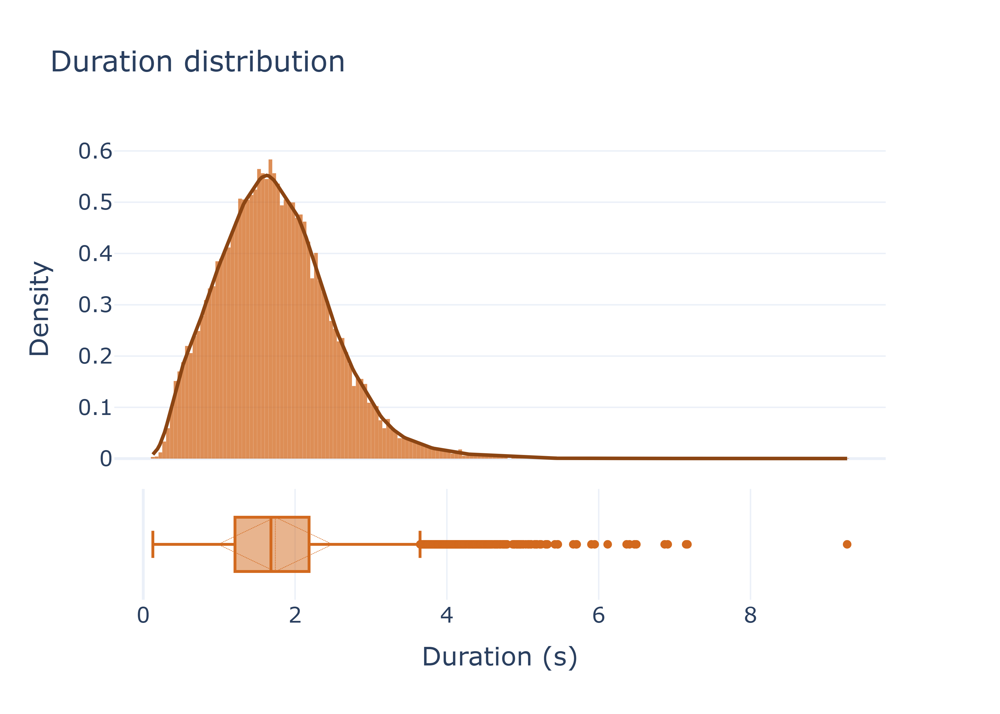

| Metric | Duration (s) |
|:------:|:------------:|
|  Mean  |     1.74     |
|   std  |     0.75     |
|   min  |     0.13     |
|   Q1   |     1.21     |
| Median |     1.68     |
|   Q3   |     2.18     |
|   max  |     9.27     |

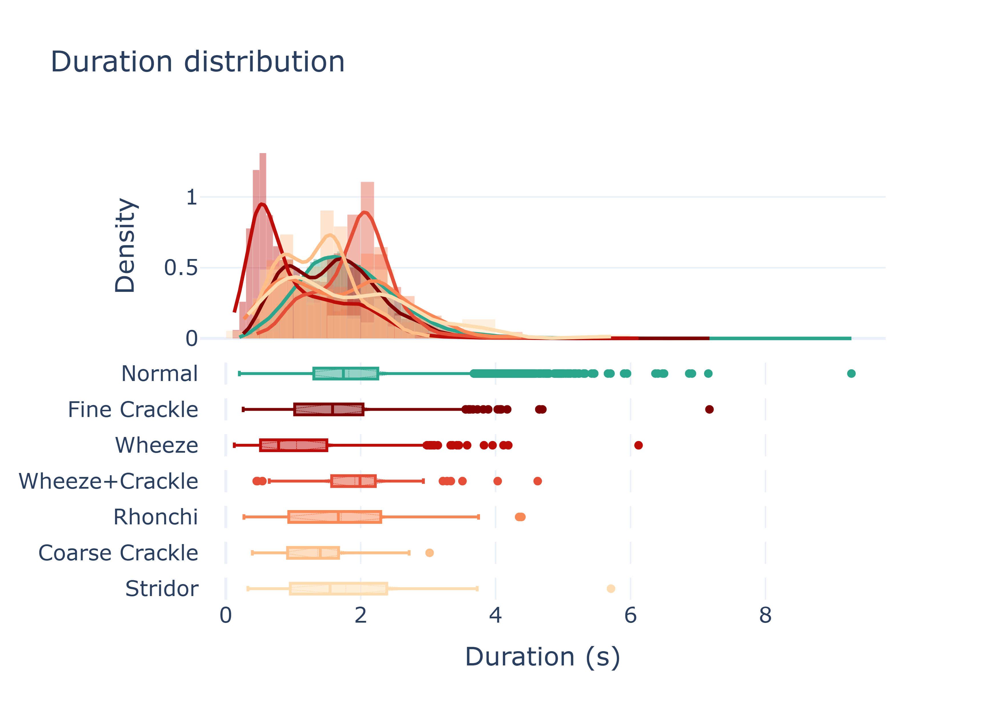

| **Metric / Duration (s)** | Normal | Fine Crackle | Wheeze | Wheeze+Crackle | Rhonchi | Coarse Crackle | Stridor |
|:-------------------------:|:------:|:------------:|:------:|:--------------:|:-------:|:--------------:|:-------:|
|            Mean           |  1.82  |     1.59     |  1.05  |      1.91      |   1.71  |      1.36      |   1.78  |
|            std            |  0.74  |     0.68     |  0.70  |      0.56      |   0.85  |      0.53      |   1.00  |
|            min            |  0.20  |     0.26     |  0.13  |      0.46      |   0.27  |      0.39      |   0.33  |
|             Q1            |  1.31  |     1.02     |  0.51  |      1.57      |   0.93  |      0.92      |   0.96  |
|           Median          |  1.74  |     1.58     |  0.78  |      1.99      |   1.67  |      1.40      |   1.55  |
|             Q3            |  2.25  |     2.03     |  1.50  |      2.22      |   2.30  |      1.67      |   2.39  |
|            max            |  9.27  |     7.17     |  6.12  |      4.62      |   4.38  |      3.02      |   5.71  |

- **Fragments per record:**
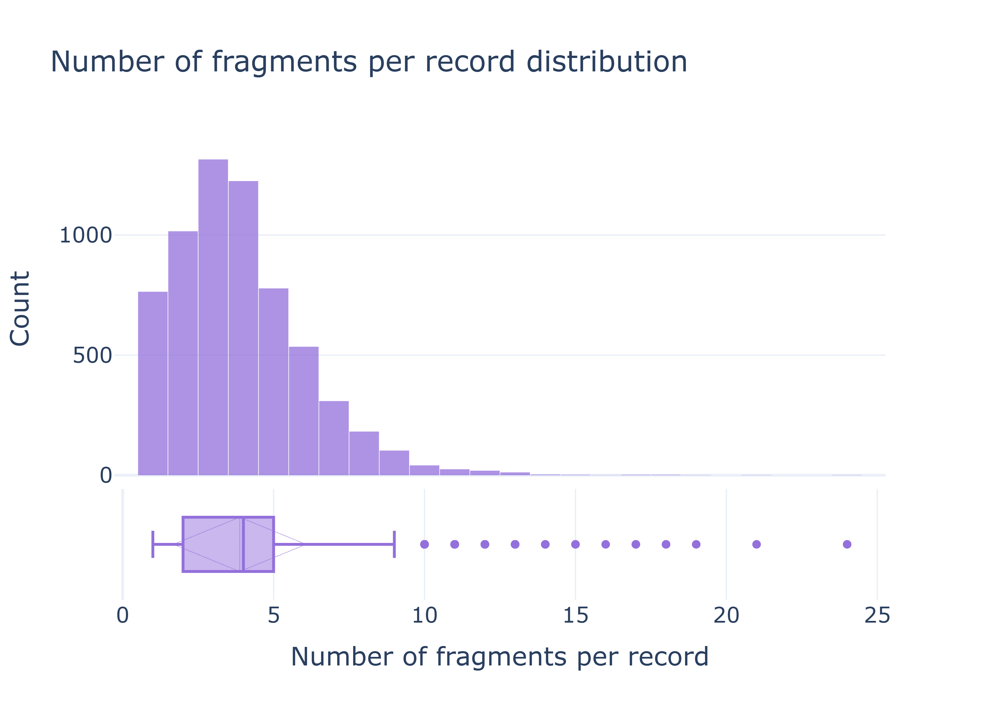

| Number of fragments per record | Count | Proportion (%) |
|:------------------------------:|:-----:|:--------------:|
|               1                |  764  |      12.06     |
|               2                |  1016 |      16.03     |
|               3                |  1315 |      20.75     |
|               4                |  1225 |      19.33     |
|               5                |   778 |      12.28     |
|               6                |   535 |      8.44      |
|               7                |   309 |      4.88      |
|               8                |   182 |      2.87      |
|               9                |   103 |      1.63      |
|               ≥10              |   110 |      1.74      |


| Metric | Fragments per record  |
|:------:|:---------------------:|
|  Mean  |          3.88         |
|   std  |          2.20         |
|   min  |           1           |
|   Q1   |           2           |
| Median |           4           |
|   Q3   |           5           |
|   max  |          24           |

- **Records per patient**


| Metric | Records per patient   |
|:------:|:---------------------:|
|  Mean  |          6.82         |
|   std  |          7.06         |
|   min  |           1           |
|   Q1   |           3           |
| Median |           5           |
|   Q3   |           8           |
|   max  |          83           |


- **Fragments per patient:** 
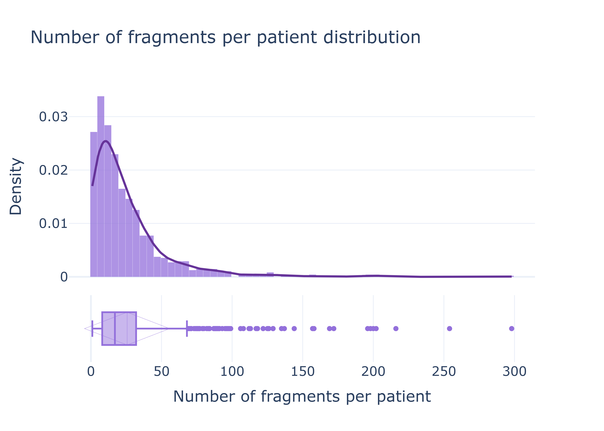

| Metric | Fragments per patient |
|:------:|:---------------------:|
|  Mean  |          25.7         |
|   std  |          30.1         |
|   min  |           1           |
|   Q1   |           8           |
| Median |           17          |
|   Q3   |           32          |
|   max  |          298          |

- **Labels per patient:**
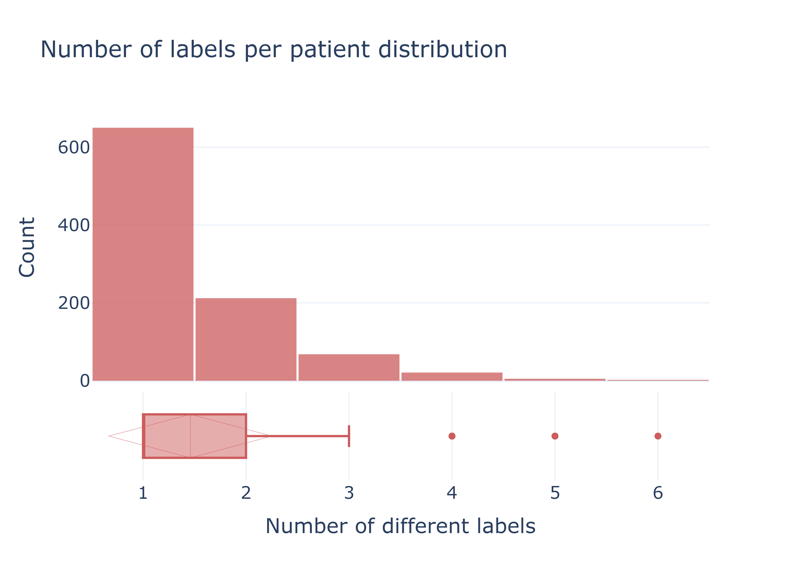

| Number of labels per patient | Count | Proportion (%) |
|:----------------------------:|:-----:|:--------------:|
|               1              |  650  |      67.85     |
|               2              |  212  |      22.13     |
|               3              |   68  |      7.10      |
|               4              |   21  |      2.19      |
|               5              |   5   |      0.52      |
|               6              |   2   |      0.21      |

| Metric | Number of labels per patient |
|:------:|:----------------------------:|
|  Mean  |              1.4             |
|   std  |              0.8             |
|   min  |               1              |
|   Q1   |               1              |
| Median |               1              |
|   Q3   |               2              |
|   max  |               6              |


- **Age vs duration by label:**
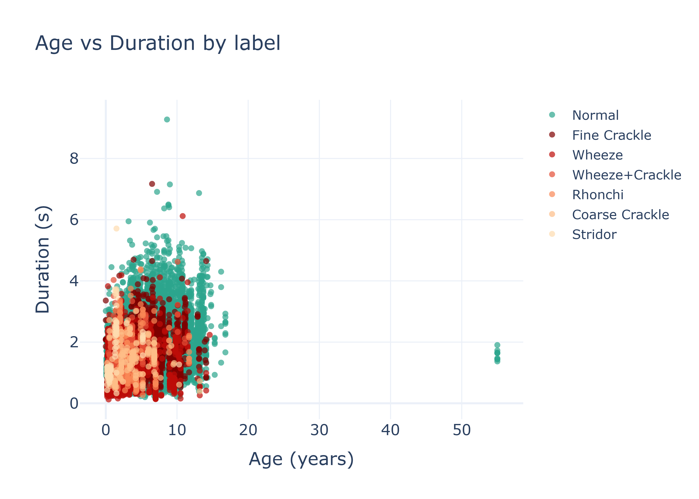

Scatter of fragment duration against patient age, colored by label. The classes overlap substantially in this 2D space, so age and duration alone do not cleanly separate the labels.

### [EDA_filtered.ipynb](EDA_filtered.ipynb) — Exploratory Data Analysis (crackle-filtered)

Repeats the [EDA.ipynb](#edaipynb--exploratory-data-analysis) analysis on the filtered dataset produced by `filter_dataset.py`: `Fine Crackle` and `Coarse Crackle` fragments are removed, `Wheeze+Crackle` is collapsed into `Wheeze`, and only the fragments lasting between 0.5 and 3 s are kept. It also adds an **Examples** section that plots a grid of random spectrogram examples per label.

#### 📝 Results

- **Descriptive parameters**:
    - Number of segments: 19064 (77.57%)
    - Number of patients: 912 (95.20%)
    - Corpus duration: 8 h 59 min 7.51 s (75.65%)
<br/><br/>

- **Label distribution:**
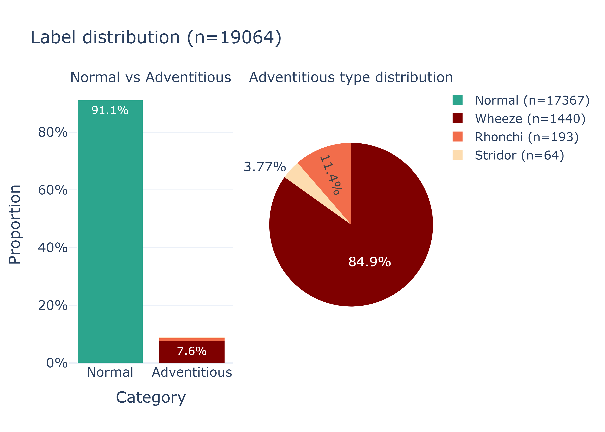

|     Category     | Proportion | Relative fraction |
|:----------------:|:----------:|:----------:|
| **Normal**       |            |            |
|      Normal      |    91.1%   |    100%    |
| **Adventitious** |            |            |
|      Wheeze      |    7.6%    |    84.9%   |
|      Rhonchi     |    1.0%    |    11.4%   |
|      Stridor     |    0.3%    |    3.77%   |

- **Age distribution:**
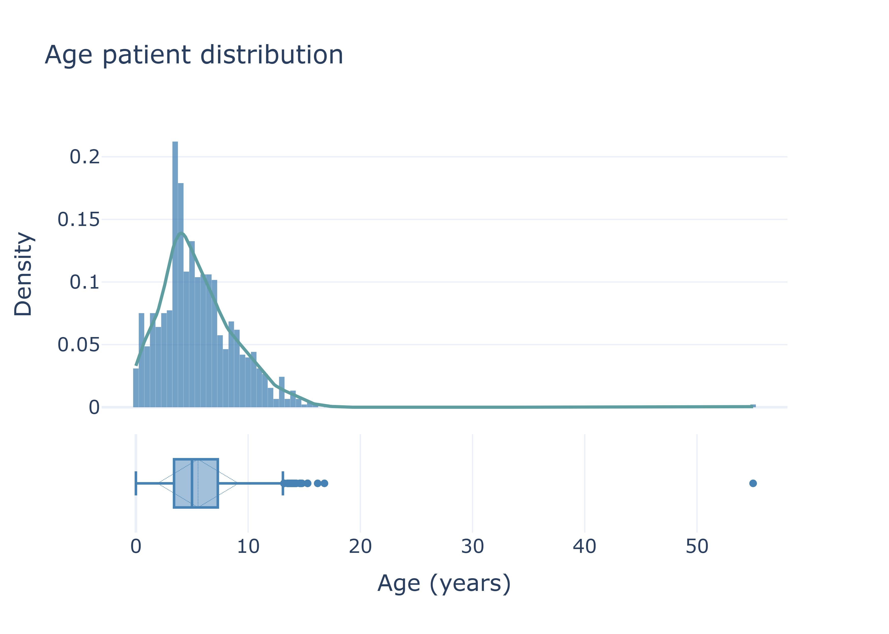

| Metric | Age (years) |
|:------:|:-----------:|
|  Mean  |     5.54    |
|   std  |     3.60    |
|   min  |       0     |
|   Q1   |     3.4     |
| Median |     5       |
|   Q3   |     7.3     |
|   max  |      55     |

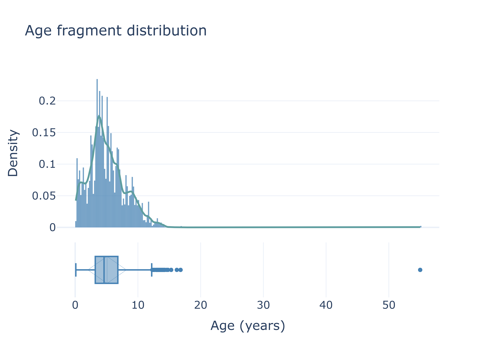

| Metric | Age (years) |
|:------:|:-----------:|
|  Mean  |     5.09    |
|   std  |     3.08    |
|   min  |       0.1   |
|   Q1   |     3.2     |
| Median |     4.6     |
|   Q3   |     6.8     |
|   max  |      55     |

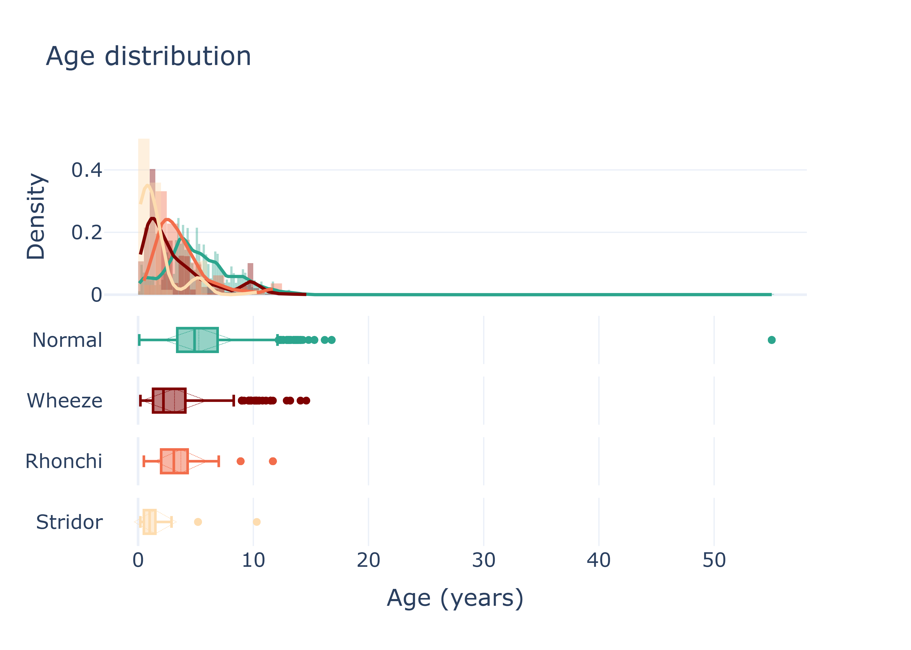

| **Metric / Age (years)** | Normal | Wheeze | Rhonchi | Stridor |
|:------------------------:|:------:|:------:|:-------:|:-------:|
|           Mean           |  5.27  |  3.16  |   3.71  |   1.49  |
|            std           |  3.04  |  2.81  |   2.28  |   1.83  |
|            min           |    0.1 |   0.2  |   0.5   |   0.2   |
|            Q1            |   3.4  |   1.3  |    2    |   0.5   |
|          Median          |    4.9 |   2.2  |   3.1   |   1     |
|            Q3            |    6.9 |   4.1  |   4.3   |   1.5   |
|            max           |   55   |  14.6  |   11.7  |   10.3  |

- **Fragment duration:**
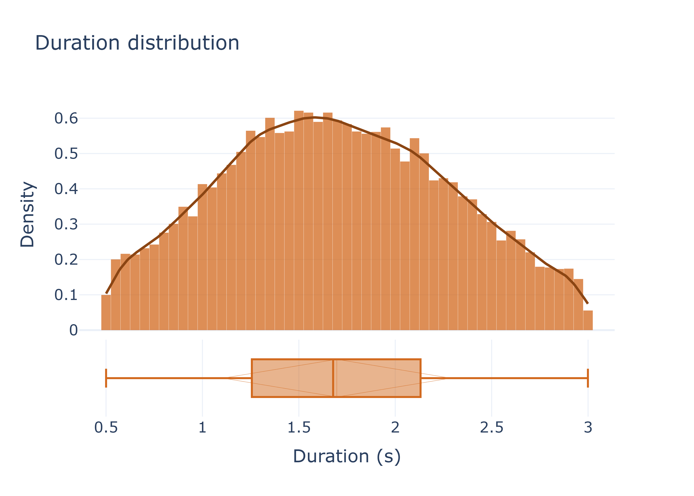

| Metric | Duration (s) |
|:------:|:------------:|
|  Mean  |     1.70     |
|   std  |     0.59     |
|   min  |     0.50     |
|   Q1   |     1.26     |
| Median |     1.68     |
|   Q3   |     2.13     |
|   max  |     3.00     |

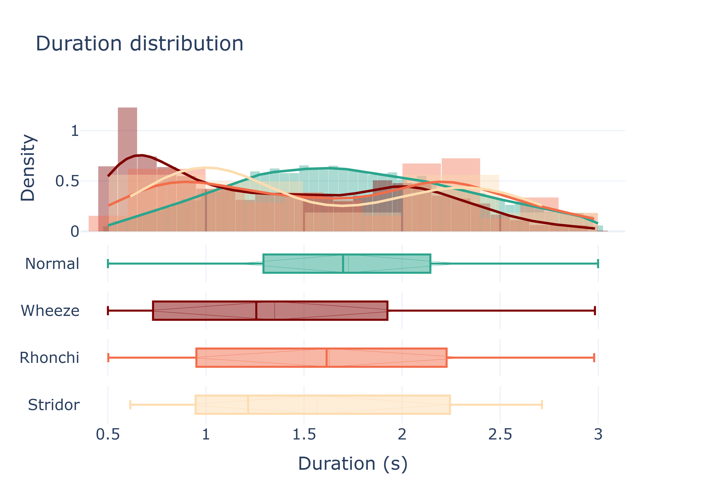

| **Metric / Duration (s)** | Normal | Wheeze | Rhonchi | Stridor |
|:-------------------------:|:------:|:------:|:-------:|:-------:|
|            Mean           |  1.73  |  1.34  |   1.63  |   1.57  |
|            std            |  0.57  |  0.65  |   0.70  |   0.67  |
|            min            |  0.50  |  0.50  |   0.50  |   0.61  |
|             Q1            |  1.29  |  0.73  |   0.95  |   0.95  |
|           Median          |  1.70  |  1.26  |   1.62  |   1.22  |
|             Q3            |  2.14  |  1.93  |   2.22  |   2.24  |
|            max            |  3.00  |  2.98  |   2.98  |   2.71  |

- **Fragments per record:**
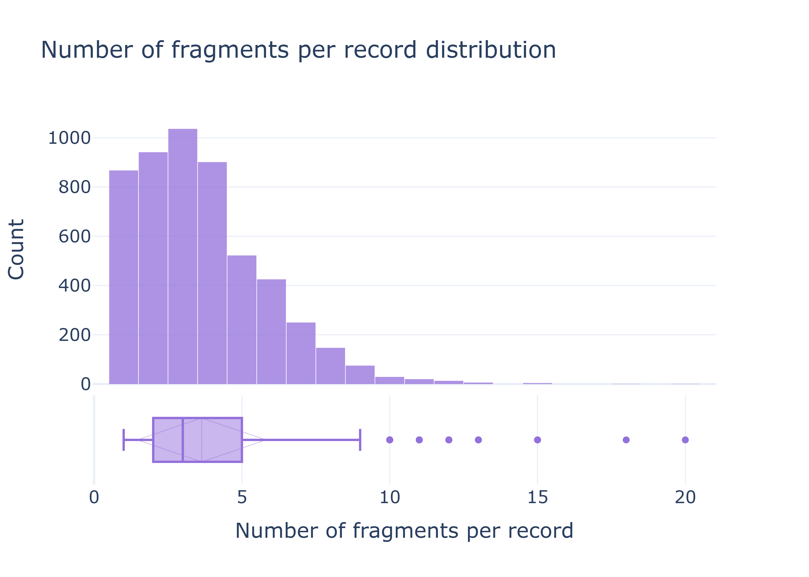

| Number of fragments per record | Count | Proportion (%) |
|:------------------------------:|:-----:|:--------------:|
|               1                |  867  |      16.55     |
|               2                |  941  |      17.96     |
|               3                |  1036 |      19.78     |
|               4                |  901  |      17.20     |
|               5                |   522 |      9.97      |
|               6                |   425 |      8.11      |
|               7                |   250 |      4.77      |
|               8                |   147 |      2.81      |
|               9                |   75  |      1.43      |
|               ≥10              |   74  |      1.41      |


| Metric | Fragments per record  |
|:------:|:---------------------:|
|  Mean  |          3.64         |
|   std  |          2.18         |
|   min  |           1           |
|   Q1   |           2           |
| Median |           3           |
|   Q3   |           5           |
|   max  |          20           |

- **Records per patient**
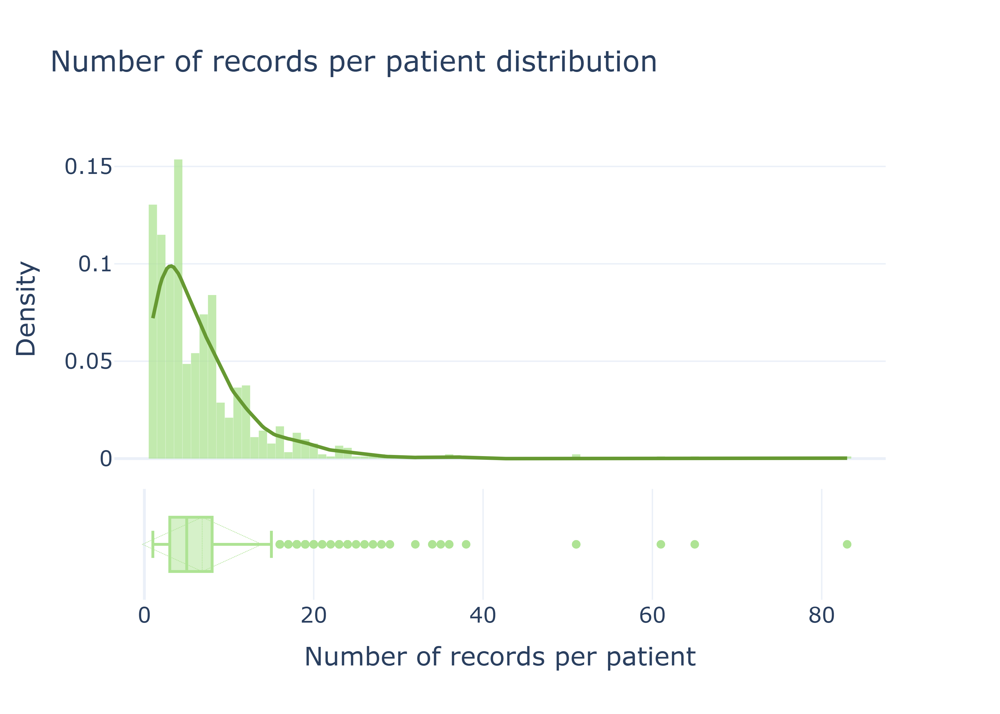

| Metric | Records per patient   |
|:------:|:---------------------:|
|  Mean  |          6.83         |
|   std  |          7.06         |
|   min  |           1           |
|   Q1   |           3           |
| Median |           5           |
|   Q3   |           8           |
|   max  |          83           |


- **Fragments per patient:** 
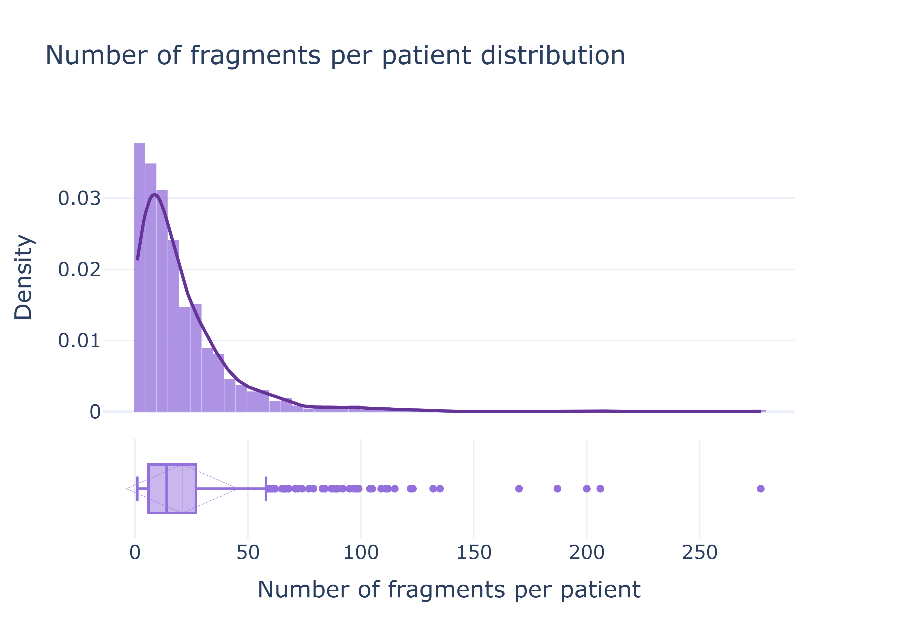

| Metric | Fragments per patient |
|:------:|:---------------------:|
|  Mean  |          20.90        |
|   std  |          24.75        |
|   min  |           1           |
|   Q1   |           6           |
| Median |           14          |
|   Q3   |           27          |
|   max  |          277          |

- **Labels per patient:**
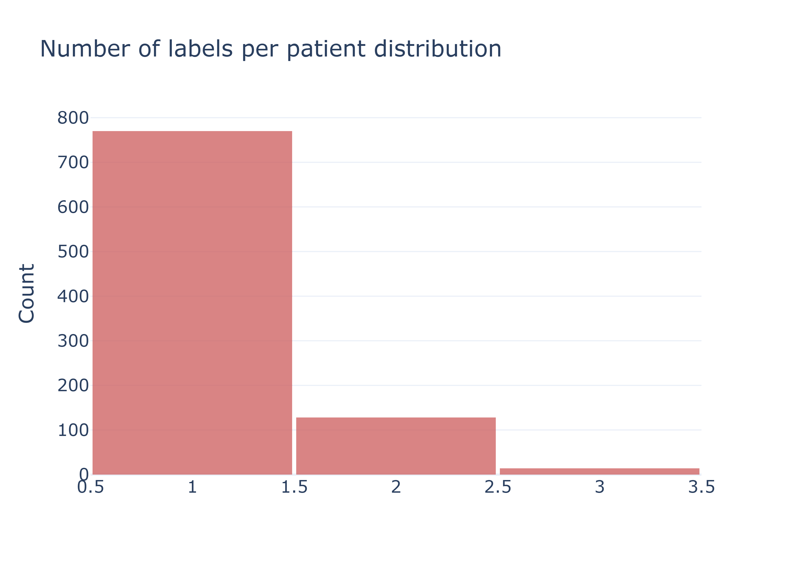

| Number of labels per patient | Count | Proportion (%) |
|:----------------------------:|:-----:|:--------------:|
|               1              |  770  |      84.43     |
|               2              |  128  |      14.04     |
|               3              |   14  |      1.54      |

| Metric | Number of labels per patient |
|:------:|:----------------------------:|
|  Mean  |              1.17            |
|   std  |              0.42            |
|   min  |               1              |
|   Q1   |               1              |
| Median |               1              |
|   Q3   |               1              |
|   max  |               3              |


- **Age vs duration by label:**
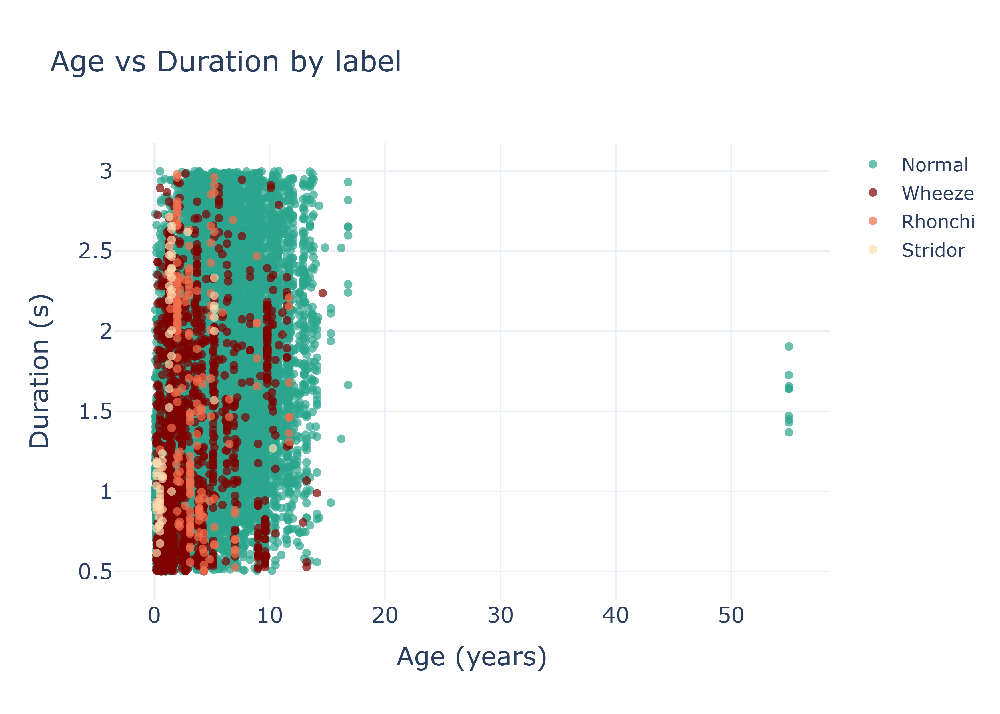

Scatter of fragment duration against patient age, colored by label. The classes overlap substantially in this 2D space, so age and duration alone do not cleanly separate the labels.

- **Spectrogram examples:**
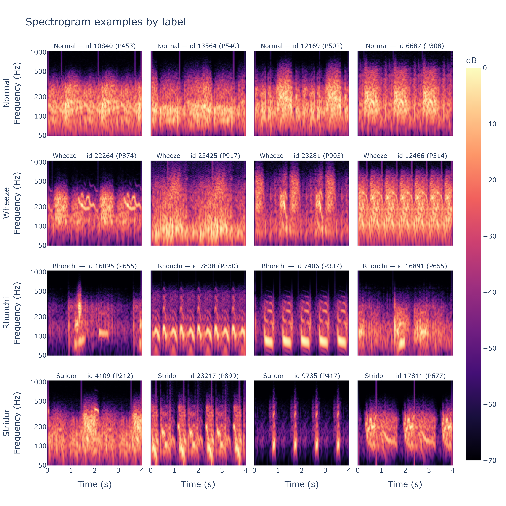
