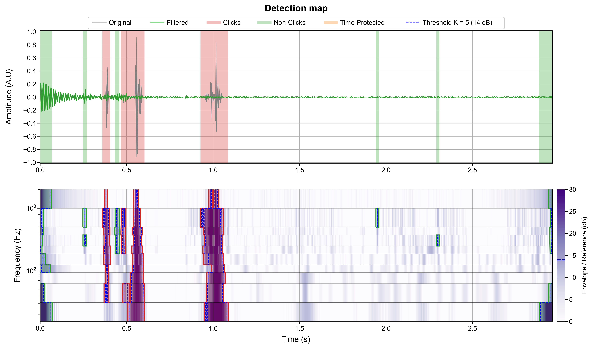
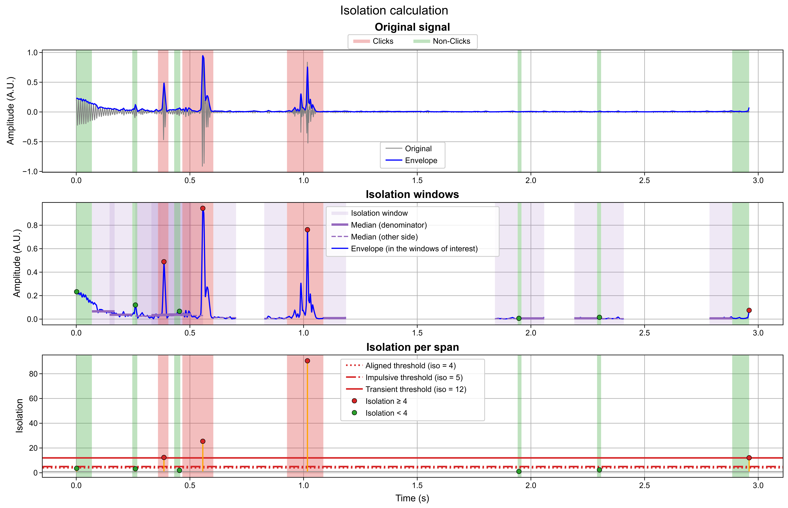
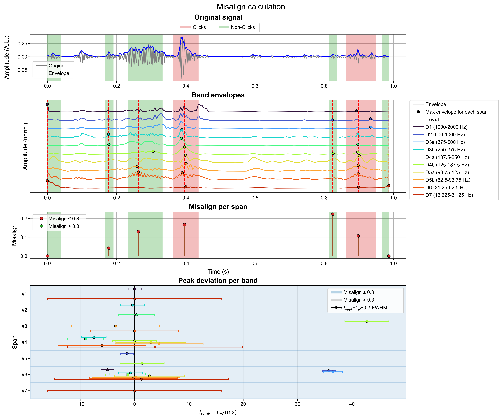
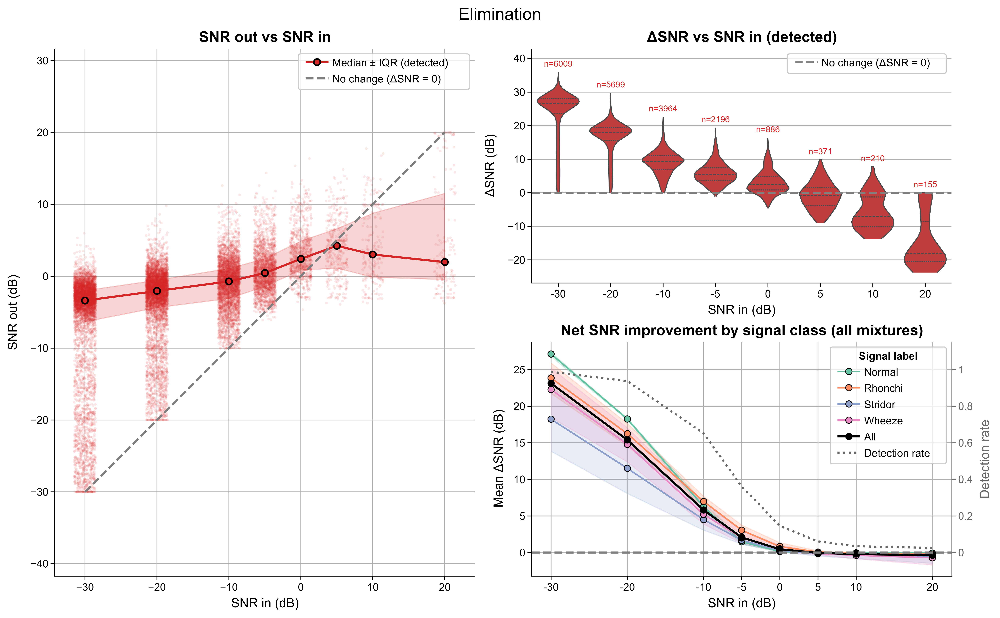
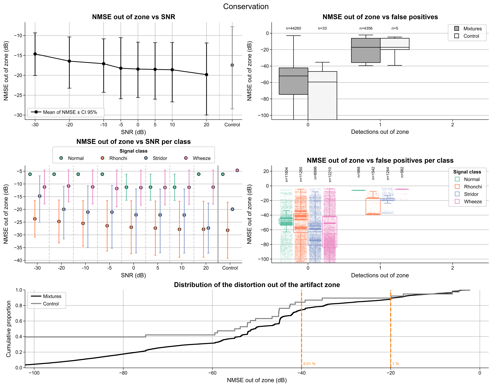
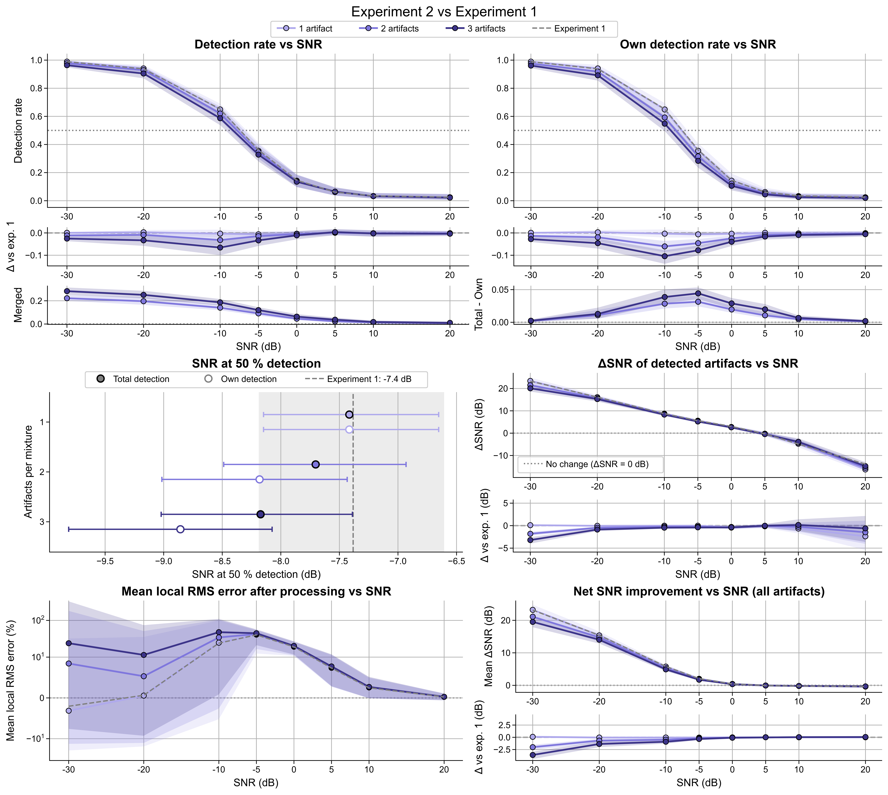

# 🧹 Denoising — Transient (Click) Removal Filter

Development of the **transient removal filter** of **EILO-BioAcoustics-Analysis**: a pre-processing step that attenuates **clicks, crackles and other short broadband transients** in the respiratory sound fragments produced by the [📊 Dataset pipeline](../dataset/README.md).

- **Why:** some fragments contain impulsive noise (stethoscope friction, contact noise, saturation of the original recording, …) loud enough to **mask the respiratory sound, or to fake one**.
- **Goal:** remove those transients **without damaging** the respiratory, adventitious or heart sounds. When in doubt, the signal is kept.
- **Origin:** a modification of `soundwaveletSWT`, an adaptive wavelet filter originally designed to attenuate heart sounds (inspired by [Zhan et al., 2010](https://doi.org/10.1016/j.jelekin.2009.07.007)). Heart sounds are **no longer a target**: they are present in every class, `Normal` included.

> ⚠️ The thresholds were **selected by eye** (visual and listening inspection of real fragments); their optimization is in progress ([PARAMETER_OPTIMIZATION.md](PARAMETER_OPTIMIZATION.md)).

> ⚠️ The current version is **not yet ported to the dataset pipeline**: `dataset/src/remove_heart_sounds.py` (used by `dataset/get_rtf.py`) still implements a previous version (see [📋 Status](#-status)).

---

## Table of Contents

- [📂 Repository layout](#-repository-layout)
- [⚙️ Quickstart](#️-quickstart)
- [🔁 Algorithm overview](#-algorithm-overview)
    - [1️⃣ Decomposition into 10 bands](#1️⃣-decomposition-into-10-bands)
    - [2️⃣ Band signals (MRA)](#2️⃣-band-signals-mra)
    - [3️⃣ Detection per band](#3️⃣-detection-per-band)
    - [4️⃣ Long-event protection](#4️⃣-long-event-protection)
    - [5️⃣ Candidate features](#5️⃣-candidate-features)
    - [6️⃣ Click rules](#6️⃣-click-rules)
    - [7️⃣ Attenuation and reconstruction](#7️⃣-attenuation-and-reconstruction)
    - [⚙️ Parameters](#️-parameters)
    - [⚠️ Known limitations](#️-known-limitations)
- [🖼️ Example](#️-example)
- [▶️ Scripts](#️-scripts)
    - [1️⃣ Evaluation experiments — run_experiment.py](#1️⃣-evaluation-experiments--run_experimentpy)
    - [2️⃣ Result figures — save_figures.py](#2️⃣-result-figures--save_figurespy)
    - [3️⃣ Tuning/test split and folds — get_splits.py](#3️⃣-tuningtest-split-and-folds--get_splitspy)
    - [4️⃣ Candidates — get_candidates.py](#4️⃣-candidates--get_candidatespy)
    - [5️⃣ Screening of the candidate generation — screen_candidates.py](#5️⃣-screening-of-the-candidate-generation--screen_candidatespy)
    - [6️⃣ Search of the candidate generation — search_candidates.py](#6️⃣-search-of-the-candidate-generation--search_candidatespy)
    - [7️⃣ Features of the candidates — get_features.py](#7️⃣-features-of-the-candidates--get_featurespy)
    - [8️⃣ Search of the features — search_features.py](#8️⃣-search-of-the-features--search_featurespy)
- [📁 Final folder layout](#-final-folder-layout)
- [📓 Notebooks](#-notebooks)
    - [denoise_soundwaveletSWT.ipynb — Transient removal filter](#denoise_soundwaveletswtipynb--transient-removal-filter)
    - [denoise_summary_plots.ipynb — Development of the summary figures](#denoise_summary_plotsipynb--development-of-the-summary-figures)
    - [evaluation_denoise.ipynb — Evaluation of the algorithm](#evaluation_denoiseipynb--evaluation-of-the-algorithm)
    - [parameter_optimization.ipynb — Parameter optimization](#parameter_optimizationipynb--parameter-optimization)
- [📈 Summary figures — summary_plots.py](#-summary-figures--summary_plotspy)
- [📋 Status](#-status)

---

## 📂 Repository layout

```
denoising/
├── assets/                        ← summary figures of the example and result figures of the evaluation (used in this file)
├── audio/                         ← the 70 fragments of the evaluation (38 clean signals + 32 artifact sources)
├── README.md                      ← this file
├── PARAMETER_OPTIMIZATION.md      ← plan of the parameter optimization (score + phases 0–5)
├── __init__.py
├── denoise_soundwaveletSWT.ipynb  ← original filter + current version of the algorithm + example
├── denoise_summary_plots.ipynb    ← development of the interactive (plotly) summary figures
├── evaluation_denoise.ipynb       ← evaluation experiments of the algorithm
├── parameter_optimization.ipynb   ← parameter optimization of the algorithm (in progress)
├── run_experiment.py              ← script 1: experiment 1 or 2 of the evaluation
├── save_figures.py                ← script 2: result figures of the experiments
├── get_splits.py                  ← script 3: tuning/test split and folds of the cross-validation
├── get_candidates.py              ← script 4: candidates of the mixtures and their metrics (phase 1)
├── screen_candidates.py           ← script 5: screening of the candidate generation (phase 1)
├── search_candidates.py           ← script 6: Bayesian search of the candidate generation → C1 (phase 1)
├── get_features.py                ← script 7: features of the candidates for a configuration (phase 2)
├── search_features.py             ← script 8: Bayesian search of the parameters of the features → C2' (phase 2)
├── src/                           ← importable modules (used by the notebooks and the scripts)
│   ├── algorithm/
│   │   ├── remove_noise.py        ← the algorithm (same code as the Funciones cell of denoise_soundwaveletSWT.ipynb)
│   │   └── summary_plots.py       ← summary figures of one fragment (used by denoise_soundwaveletSWT.ipynb)
│   ├── evaluation/
│   │   ├── evaluation.py          ← mixtures, metrics and parallel execution of experiments 1 and 2
│   │   └── evaluation_plots.py    ← plotly result figures of experiments 1 and 2 (copy of the notebook; used by save_figures.py)
│   └── optimization/
│       ├── splits.py              ← loading of the tuning/test split and folds, split of the results into the four sets
│       ├── candidate_score.py     ← metrics of the candidate generation (copy of sections 2 and 4.1 of the notebook)
│       ├── candidate_search.py    ← protocol of the search of phase 1: search space, constraints, (a)/(b)/b2, choice of C1, folds
│       ├── feature_score.py       ← metric of the features (copy of section 5.1 of the notebook)
│       ├── feature_search.py      ← protocol of the search of phase 2: search space of each group, default + TPE, choice of C2'
│       └── configs.py             ← configurations baseline, C1 and C2 (constants of remove_noise; option -c of the scripts)
└── results/                       ← experiments and their figures (see 📁 Final folder layout)
```

- The notebooks import the modules as a package from `denoising/` (e.g. `from src.algorithm import remove_noise as rn`), so they must be run with `denoising/` as the working directory.
- They read the fragments of step 4 of the [📊 Dataset pipeline](../dataset/README.md#4️⃣-extract-annotated-respiratory-fragments--get_fragmentspy) (`dataset/dataset/audio/{id}.wav`, 4 kHz), except the evaluation (`evaluation_denoise.ipynb`, but its *Example*), which reads `denoising/audio/`, so the experiments can be reproduced without regenerating the dataset.

---

## ⚙️ Quickstart

The algorithm is [src/algorithm/remove_noise.py](src/algorithm/remove_noise.py) and its summary figures [src/algorithm/summary_plots.py](src/algorithm/summary_plots.py). From `denoising/`:

```python
import soundfile as sf

from src.algorithm import remove_noise as rn
from src.algorithm.summary_plots import summary_plots

signal, fs = sf.read(rf"..\dataset\dataset\audio\{file}.wav")  # file: fragment id

clean = rn.remove_noise(signal, fs)                                 # Filtered signal (same length as signal)
clean, details = rn.remove_noise(signal, fs, return_details=True)   # + intermediate results
stages = rn.generate_candidates(signal, fs)  # Steps 1-4: candidates (stages["candidate_span"]), no classification
stages = rn.generate_features(signal, fs)    # Steps 1-5: candidates and their features (stages["features"])

# Summary figures: they need some constants of the algorithm; save_dir -> also saved as .png
PARAMS = dict(G_FAC=rn.G_FAC, K=rn.K, Z_CLICK=rn.Z_CLICK, Z_TOLERANCE=rn.Z_TOLERANCE, AR_ORDER=rn.AR_ORDER,
              ISO_WIN=rn.ISO_WIN, ISOLATION=rn.ISOLATION, ISOLATION_IMPULSIVE=rn.ISOLATION_IMPULSIVE,
              ISOLATION_ALIGNED=rn.ISOLATION_ALIGNED, MAX_MISALIGN=rn.MAX_MISALIGN)
summary_plots(signal, fs, details, PARAMS, save_dir="assets", scale=5)
```

- The parameters ([⚙️ Parameters](#️-parameters)) are module constants: set them before calling, e.g. `rn.K = 6`.
    - ⚠️ Except `MAX_EVENT` and `SPLIT_LEVELS`: they are the default values of the arguments `max_event` and `split_levels` of `remove_noise`, `generate_candidates` and `generate_features`, fixed when the module is imported. Pass them as arguments, e.g. `rn.remove_noise(signal, fs, max_event=0.2)`.
- The **Funciones** cell of [denoise_soundwaveletSWT.ipynb](#denoise_soundwaveletswtipynb--transient-removal-filter) holds a copy of the same code, to read it step by step next to the original filter.

---

## 🔁 Algorithm overview

`remove_noise(signal, fs)` works in 7 steps:

| Step | What it does | Output |
|:----:|:-------------|:-------|
| **1** | SWT (`db4`) + split of 3 levels | 10 frequency bands |
| **2** | Reconstruction of each band alone (MRA) | Time-domain signal of each band |
| **3** | Envelope vs. local reference (`K` times) | Detection mask per band |
| **4** | Long events (> 140 ms) are kept | Mask without respiratory/adventitious sounds |
| **5** | Union of the bands → candidate spans, 8 features each | Candidates |
| **6** | 4 click rules + border rule | Click spans |
| **7** | Gain < 1 inside the clicks, sum of the bands | Filtered signal |

- Before step 1, only the first channel is used and its mean is removed; the signal is padded at the end (mirror) up to a multiple of 2⁸ samples, as the SWT requires, and cropped back at the end.
- Steps 1–4 (candidate generation) are `generate_candidates` and steps 1–5 (candidates and their features) `generate_features`, which `remove_noise` calls first. They can be called alone (phases 1 and 2 of the [parameter optimization](#parameter_optimizationipynb--parameter-optimization)).

### 1️⃣ Decomposition into 10 bands

1. **SWT** (`db4`) until the approximation is below ~15 Hz (`F_APPROX`): **7 detail levels** at 4 kHz, one octave each.
2. **Band splitting:** levels 3, 4 and 5 (62–500 Hz, `SPLIT_LEVELS`) are split into 2 half-bands with one more SWT step, with the filters dilated to that level (*stationary wavelet packet*).
3. **10 bands**, from high to low frequency. The approximation (< 15 Hz) is discarded.

| Band | D1 | D2 | D3a | D3b | D4a | D4b | D5a | D5b | D6 | D7 |
|:-----|:--:|:--:|:---:|:---:|:---:|:---:|:---:|:---:|:--:|:--:|
| **Frequency (Hz)** | 1000–2000 | 500–1000 | 375–500 | 250–375 | 188–250 | 125–188 | 94–125 | 62–94 | 31–62 | 16–31 |
| **FWHM (ms)** | 4.0 | 4.0 | 6.0 | 7.5 | 11.0 | 13.5 | 21.5 | 27.0 | 27.0 | 53.5 |

> **FWHM:** time resolution of each band, the Full Width at Half Maximum of the envelope of its response to a unit impulse (`band_resolution`): the narrowest an event can look in that band.

### 2️⃣ Band signals (MRA)

Each band is reconstructed **alone**, the coefficients of the rest set to 0 (multiresolution analysis, `band_signals`):

- Each band signal is the output of a **zero-phase** filter (analysis + its adjoint): an event appears at the **same instant in every band**.
- By linearity, the sum of the 10 band signals is the original signal (> 15 Hz).
- The following steps work on these band signals, so the filtered signal only changes **where some gain is < 1**.

### 3️⃣ Detection per band

1. **Envelope:** magnitude of the analytic signal (Hilbert), smoothed with a 4 ms moving average (`ENV_SMOOTH`).
2. **Local reference:** median of the envelope **0.1–0.4 s at each side** of every sample (`REF_INNER`, `REF_OUTER`); the central ±0.1 s are excluded so the event does not raise its own reference. Computed every 5 ms and interpolated (`REF_STEP`).
3. **Detection:** envelope > **`K = 5` × reference** (~14 dB). The mask is widened 15 ms (`MASK_DILATION`).

> Very short fragments (< ~0.2 s) can have no reference at all: no detection there.

### 4️⃣ Long-event protection

Clicks, crackles and S1/S2 are short; respiratory and adventitious sounds (wheezes, stridor, rhonchi) are long.

- A detected event **longer than 140 ms** (`MAX_EVENT`) is a respiratory/adventitious sound: removed from the mask (kept in the signal).
- Only in the **band where it is detected** (`PROTECT_LEVELS = 0`): in the low bands, the long filters merge close short impulses into one "long" event, which would otherwise protect them in every band.
- Border protection is disabled (`EDGE = 0`): the borders are handled by the border rule of step 6.

### 5️⃣ Candidate features

The time spans where **some band** still has a detection are the **candidates**. Their features (`candidate_features`):

| Feature | Definition |
|:--------|:-----------|
| `bands` | Number of bands with a detection in the span |
| `r_med` / `r_max` | Intensity (envelope / reference): median over the detected bands of the maximum in the span / maximum over all the bands |
| `width_med` / `width_max` | **Effective width**, median / maximum over the detected bands (`effective_width`): area / height of the band envelope above a floor (the larger of 2 × the median reference, `BG_FACTOR`, and the peak − 20 dB, `WIDTH_FLOOR_DB`), scaled to the FWHM of a Gaussian, measured on the span extended 2 FWHM of the band at each side (`EXTEND`). Unlike the time above the threshold, it does not grow with the intensity; it includes the time resolution of each band |
| `misalign` | Alignment of the band peaks: median over the detected bands of \|t_peak − t_ref\| / FWHM (t_ref: median of the peak times). A click is a singularity, aligned across scales (≈ 0); a respiratory or adventitious sound builds up and decays at different times in each band (~0.3–1) |
| `z_max` | Maximum **impulsiveness** in the span (±10 ms, `Z_TOLERANCE`): a robust **AR(20)** model of the fragment (Huber M-estimator, IRLS; AR click detector of Godsill & Rayner) predicts each sample, and `z` = \|prediction error\| / local robust scale (0.1 s, `Z_WIN`). Respiratory, heart and tonal adventitious sounds are predictable (low `z`); the onset of a click is not |
| `isolation` | Peak of the full-band envelope in the span / the larger of its medians in the **0.1 s before and after** (`ISO_WIN`). The onset of a wheeze or stridor only stands out over what comes before; a click or crackle stands out over **both** sides |

### 6️⃣ Click rules

A candidate is a **click** (attenuated) if it meets **all the conditions of any** rule:

| Rule | Target | Conditions |
|:-----|:-------|:-----------|
| **1. Broadband click** | Strong, narrow click in most bands | `bands` ≥ 6 · `r_med` ≥ 8 · `width_med` ≤ 30 ms |
| **2. Impulsive click** | Very impulsive click, in few bands | `z_max` > 30 · `r_max` > 30 · `width_med` ≤ 70 ms · `isolation` ≥ 5 |
| **3. Isolated transient** | Crackles, even in a single band | `r_max` ≥ 12 · `width_max` ≤ 35 ms · `isolation` ≥ 12 |
| **4. Aligned transient** | Thumps, short scrapes, low-band clicks | `bands` ≥ 4 · `misalign` ≤ 0.3 · `width_med` ≤ 25 ms · `r_med` ≥ 8 · `isolation` ≥ 4 |

- **Border rule:** a candidate closer than 10 ms to a border (`EDGE_CLICK`) is only a click if also `z_max` > 20 (`Z_EDGE`): its real duration is unknown (e.g. an adventitious sound cut by the annotation).
- All the other candidates (heart sounds, bursts of adventitious sounds, breathing, …) are **kept**.

> No single feature works alone: after the 70–1900 Hz band-pass filter, many clear clicks have a low `z`, and bursts of wheeze, stridor and rhonchi are also broadband.

> Crackles are removed on purpose: the target classes are the continuous adventitious sounds (in SPRSound this also removes the crackle part of `Wheeze+Crackle`, see [dataset step 6](../dataset/README.md#6️⃣-filter-fragments-by-label-and-duration--filter_datasetpy)).

### 7️⃣ Attenuation and reconstruction

1. **Where:** inside each click span, only the samples **detected in each band** (after the protection): a protected long event is never attenuated, not even under a click.
2. **Reference:** the **immediate background**, median envelope in the 50 ms before and after the click (`LOCAL_BG`), if lower than the 0.1–0.4 s reference (which can include a nearby loud sound).
3. **Gain:** min(1, `G_FAC` · reference / envelope), with **`G_FAC = 1.5`**; 1 everywhere else. Smoothed 5 ms (`GAIN_SMOOTH`): an abrupt step leaves audible tics.
4. **Reconstruction:** Σ (gain × band signal) over the 10 bands: same length as the input, without the < 15 Hz component.

> `K` decides **where** to act, `G_FAC` **how much**: `G_FAC = 0` leaves gaps, `1` leaves the event at the background median, `1.5` approximately at the respiratory sound level, `K` almost does not attenuate.

### ⚙️ Parameters

All the thresholds were **selected by eye**, pending their optimization ([PARAMETER_OPTIMIZATION.md](PARAMETER_OPTIMIZATION.md)).

| Group | Parameter | Value | Role |
|:------|:----------|:------|:-----|
| Decomposition | `WAVELET` / `F_APPROX` | `db4` / 15 Hz | Wavelet and lower limit of the decomposition |
| | `SPLIT_LEVELS` | [3, 4, 5] | Levels split into 2 half-bands (`None` → 7 bands) |
| Detection | `K` | 5 | Detection threshold (times the reference) |
| | `REF_INNER` / `REF_OUTER` | 0.1 / 0.4 s | Reference window at each side of the sample |
| | `REF_STEP` | 5 ms | Reference computed every 5 ms and interpolated (`None` → every sample) |
| | `ENV_SMOOTH` / `MASK_DILATION` | 4 / 15 ms | Envelope smoothing / mask widening |
| Protection | `MAX_EVENT` | 0.14 s | Longer events are kept (`None` → no protection) |
| | `PROTECT_LEVELS` | 0 | A long event in band *b* protects bands *b* ± `PROTECT_LEVELS` (`None` → all) |
| | `EDGE` / `PROTECT_MARGIN` | 0 / 0 s | Border protection and widening of the protected zones (disabled) |
| Width | `BG_FACTOR` / `WIDTH_FLOOR_DB` / `EXTEND` | 2 / 20 dB / 2 FWHM | Floor and window of the effective width |
| Rule 1 | `MIN_BANDS` / `R_MED` / `MAX_WIDTH` | 6 / 8 / 30 ms | Broadband click |
| Rule 2 | `Z_CLICK` / `R_CLICK` / `MAX_WIDTH_IMPULSIVE` / `ISOLATION_IMPULSIVE` | 30 / 30 / 70 ms / 5 | Impulsive click |
| Rule 3 | `R_TRANSIENT` / `MAX_WIDTH_TRANSIENT` / `ISOLATION` / `ISO_WIN` | 12 / 35 ms / 12 / 0.1 s | Isolated transient |
| Rule 4 | `MIN_BANDS_FEW` / `MAX_MISALIGN` / `MAX_WIDTH_ALIGNED` / `R_MED_ALIGNED` / `ISOLATION_ALIGNED` | 4 / 0.3 / 25 ms / 8 / 4 | Aligned transient |
| Border | `EDGE_CLICK` / `Z_EDGE` | 10 ms / 20 | Border candidates also need `z_max` > `Z_EDGE` |
| Impulsiveness | `AR_ORDER` / `HUBER_C` / `HUBER_ITER` | 20 / 1.345 / 10 | Robust AR model |
| | `Z_WIN` / `Z_STEP` / `Z_TOLERANCE` | 0.1 s / 5 ms / 10 ms | Local scale of the prediction error; tolerance around the span |
| Attenuation | `G_FAC` | 1.5 | Attenuation level (times the reference) |
| | `LOCAL_BG` / `GAIN_SMOOTH` | 50 / 5 ms | Immediate background / gain smoothing |

### ⚠️ Known limitations

- A click **inside a long sound** (e.g. within a stridor) is protected by step 4.
- **Weak** clicks and crackles (little above their band background, or not isolated) are missed; so are long scrapes and weak low-frequency thumps.
- Transients at the **borders** are only removed if they are very impulsive (`z_max` > 20).
- The rules were tuned by eye on a limited set of fragments: a missed noise is accepted as long as it does not mask the respiratory sound.

---

## 🖼️ Example

Summary figures of the filter applied to a fragment ([denoise_soundwaveletSWT.ipynb](#denoise_soundwaveletswtipynb--transient-removal-filter)). **Red** spans: clicks (attenuated); **green**: candidates that are not clicks (kept).

**Decomposition summary:** original signal; one row per band with the band signal (gray), filtered (green), envelope (blue), threshold `K` × reference (red), gain and removed component; filtered signal and removed component.


**Detection map:** original and filtered signal with the candidates; envelope / reference (dB) of each band in time, with the detections (red: attenuated, green: kept, orange: protected long event; dashed blue: `K`).



**Impulsiveness:** robust AR(20) model (signal vs. prediction, prediction error and local scale, Huber weights, `z` with the `z_max` of each candidate and `Z_CLICK`); PSD of signal, prediction and error, frequency response and poles of the model.


**Isolation:** full-band envelope, the windows before and after each candidate with their medians, and its `isolation` with the thresholds of rules 2, 3 and 4.



**Misalign:** normalized envelope of each band with its peak in each candidate, `misalign` of each candidate and deviation of each peak from t_ref (±0.3 FWHM). The clicks have their peaks aligned in almost every band.



**Click classification:** every condition of every rule for each candidate (✓/✗, value and threshold; green: rule met).


**Noise removal:** original (> 15 Hz), filtered and residual, each with its spectrogram (50–1050 Hz, as the RTFs; the residual normalized to the maximum of the original).


**Effect in frequency:** original vs. filtered and residual, PSD of the three and attenuation (dB), and removed energy per band (% of its energy).


---

## ▶️ Scripts

Terminal versions of the heavy parts of the notebooks (e.g. for the HPC), **in order of execution**. All of them run from any folder (e.g. the repository root) and accept `-p, --processes` (worker processes; default: one per CPU core).

| Step | Script | Notebook (sections) | Requires | Output |
|:----:|:-------|:--------------------|:---------|:-------|
| **1** | `run_experiment.py` | evaluation (4, 5.1, 6.1); optimization (5.6, `C2`) | `audio/`; 6 (`C1`); 8 (`C2`) | `results/experiments/<config>/experiment_{1,2}.csv` |
| **2** | `save_figures.py` | evaluation (5.4, 6.4) | step 1 (same configuration) | `results/figures/<config>/experiment_{1,2}/` |
| **3** | `get_splits.py` | optimization (3.1) | — | `splits/` |
| **4** | `get_candidates.py` | optimization (4.1–4.2) | steps 1, 3 | `results/optimization/candidates/<name>/` |
| **5** | `screen_candidates.py` | optimization (4.3) | steps 1, 3 | `results/optimization/candidates/screening/` |
| **6** | `search_candidates.py` | optimization (4.4–4.5) | steps 1, 3, 4 (`baseline/tune.csv`) | `results/optimization/candidates/search/` |
| **7** | `get_features.py` | optimization (5.1–5.5) | steps 1, 3; 6 (`C1`); 8 (`C2`) | `results/optimization/features/<config>/` |
| **8** | `search_features.py` | optimization (5.2.2–5.4.2) | steps 3, 6, 7 (`C1/tune.csv`) | `results/optimization/features/search/<group>/` |

> Some modules are **copies of notebook code**: if the notebook changes, they must also be changed. `run_experiment.py` (constants, signals and mixtures of evaluation 4, 5.1 and 6.1), `evaluation_plots.py` (evaluation 5.4 and 6.4), `candidate_score.py` (optimization 2 and 4.1) and `feature_score.py` (optimization 5.1).

---

### 1️⃣ Evaluation experiments — [run_experiment.py](run_experiment.py)

Rebuilds the mixtures of experiment 1 or 2 of [evaluation_denoise.ipynb](#evaluation_denoiseipynb--evaluation-of-the-algorithm) (`get_mixes_1`, `get_mixes_2`: identical to the notebook) and processes them with `run_experiment` ([evaluation.py](src/evaluation/evaluation.py)), with the constants of the algorithm of a configuration (`-c`, [configs.py](src/optimization/configs.py)):

| Configuration (`-c`) | Constants of `remove_noise` |
|:---------------------|:----------------------------|
| `baseline` (default) | Default constants (the evaluation of the notebook) |
| `C1` | + C1 (`results/optimization/candidates/search/all.json`, step 6) |
| `C2` | + C1 + C2' (`results/optimization/features/search/<group>/all.json`, step 8): full run of phase 2 |

```bash
python denoising/run_experiment.py -e 1        # Experiment 1: single artifact (baseline)
python denoising/run_experiment.py -e 2 -p 4   # Experiment 2: several artifacts + idempotence
python denoising/run_experiment.py -e 1 -c C2  # Experiment 1 with C2 (full run of phase 2, optimization 5.6)
```

**Generates:** `results/experiments/<config>/experiment_{1,2}.csv` (`baseline`: the **same file** as the notebook; load it with `read_results(experiment_file(1, config))`); overwritten. Steps 4–8 read the mixtures of `baseline/experiment_1.csv`.

---

### 2️⃣ Result figures — [save_figures.py](save_figures.py)

Saves (does not show) the plotly result figures of the experiments ([evaluation_plots.py](src/evaluation/evaluation_plots.py), entry point `save_figures(experiment, config)`), once the `.csv` of the experiment exists with the same configuration (`-c`, as step 1).

```bash
python denoising/save_figures.py                       # Experiments 1 and 2 (baseline)
python denoising/save_figures.py -e 1 -c C2            # -e: only experiment 1 or 2; -c: configuration
python denoising/save_figures.py -e 2 -f idempotence   # -f: only some figures; -s: scale of the .png (default: 5)
```

**Generates:** `results/figures/<config>/experiment_{1,2}/<name>.{png,svg,html}` (plotly.js from the CDN); overwritten. Names: `detection`, `elimination`, `conservation`, `amplitude`, `factor_analysis` (experiment 1); `experiment_comparison` (also reads `experiment_1.csv` of the same configuration), `interaction_artifacts`, `mixture_performance`, `conservation_multiple`, `idempotence` (experiment 2).

---

### 3️⃣ Tuning/test split and folds — [get_splits.py](get_splits.py)

Split of the mixtures of experiment 1 for [parameter_optimization.ipynb](#parameter_optimizationipynb--parameter-optimization) (`StratifiedGroupKFold`, `RANDOM_STATE = 42`): the clean signals grouped by `clean_id` and stratified by label, the artifacts grouped by `art_id` and stratified by duration.

- **Tuning/test:** the first of 4 folds is the test set.
- **Cross-validation:** the tuning clean signals and artifacts are split again into 5 folds, the same way (nested cross-validation of phases 1 and 2).

```bash
python denoising/get_splits.py
```

**Generates:** `splits/clean_split.csv` (`clean_id`, `label`, `set`), `splits/artifact_split.csv` (`art_id`, `art_duration_ms`, `set`), with `set` = `tune` / `test`; `splits/cv_clean_folds.csv` and `splits/cv_artifact_folds.csv` (`fold` = 1–5). Versioned, so the HPC and the notebook use the same split (regenerated identically with the same seed).

---

### 4️⃣ Candidates — [get_candidates.py](get_candidates.py)

Rebuilds each mixture of `baseline/experiment_1.csv` (all the SNR) and its control, generates its candidates (`generate_candidates`, default constants) and computes their metrics against the zone of the artifact (±25 ms, `candidate_metrics`).

```bash
python denoising/get_candidates.py               # All the mixtures of experiment 1
python denoising/get_candidates.py -s tune       # -s: tune, test, new_signals or new_artifacts
python denoising/get_candidates.py -n baseline   # -n: output folder (default: baseline)
```

**Generates:** `results/optimization/candidates/<name>/<set>.csv` (`all.csv` without `-s`), one row per mixture and control (zone metrics NaN in the controls):

- `n_candidates` (candidates of the signal), `n_candidates_out` (that do not touch the zone), `has_candidate` (some touches it).
- `zone_ms` / `overflow_ms`: length of the zone / time of the candidates that touch it outside it.
- `cand_start`, `cand_end`: span of each candidate (JSON lists; read with `read_results`).

`baseline/tune.csv` is required by step 6 (versioned).

---

### 5️⃣ Screening of the candidate generation — [screen_candidates.py](screen_candidates.py)

Each parameter of the candidate generation is varied **alone** (the others at their default value, **bold**), on the tuning set; its candidates are generated with `run_candidates` (step 4, not saved) and scored with `candidate_score` ([candidate_score.py](src/optimization/candidate_score.py)).

| Parameter | Values |
|:----------|:-------|
| `WAVELET` | db1, db2, **db4**, db6, db8, db10, coif2, coif4 |
| `K` | 1, 3, **5**, 7, 9, 11, 13, 15 |
| `ENV_SMOOTH` | 0, 1, 2, **4**, 8, 16, 32, 64 ms (0 → no smoothing) |
| `MASK_DILATION` | 0, 5, 10, **15**, 20, 25, 30, 40 ms (0 → no widening) |
| `REF_INNER` | 10, 20, 30, 50, 70, **100**, 150, 200 ms |
| `REF_OUTER` | 250, 300, **400**, 500, 600, 700, 800, 900 ms |
| `MAX_EVENT` | 60, 80, 100, 110, 120, 130, **140**, 160 ms |

```bash
python denoising/screen_candidates.py                            # All the parameters, on the tuning set
python denoising/screen_candidates.py --params K MASK_DILATION   # --params: only some; -s: set (default: tune)
```

**Generates:** `results/optimization/candidates/screening/<PARAMETER>.csv`, one row per value: `value`, `default`, metrics (`recall`, `load`, `w_med`), diagnostics (`recall_unweighted`, `recall_w`, `overflow_ms_med`, `load_mix`) and recall per SNR (`recall_-30` … `recall_20`). Rewritten after each value (an interrupted run keeps the values done). Each value is a full run of the tuning set (~26 700 mixtures): 56 runs in total.

---

### 6️⃣ Search of the candidate generation — [search_candidates.py](search_candidates.py)

Bayesian search (Optuna TPE) of phase 1 ([candidate_search.py](src/optimization/candidate_search.py)) → **C1**:

- **(a) Maximum recall** → recall<sub>max</sub> and its SE (bootstrap grouped by signal and artifact).
- **(b) Minimum load** with recall ≥ recall<sub>max</sub> − SE and median $w_i$ ≥ that of the baseline, starting from the configurations of (a); **safeguard (b2)** if no configuration meets both.
- **C1:** minimum load among the configurations that meet the constraints. `REF_OUTER` is searched from `REF_INNER` + `MAX_EVENT` (constraint met by construction); `MAX_EVENT` is fixed (140 ms).
- **Nested cross-validation:** each of the 5 folds runs the protocol on its training mixtures (~64 % of the tuning set) and evaluates its C1 and the baseline on its validation mixtures; the run `all` repeats it on the whole tuning set (final C1).

```bash
python denoising/search_candidates.py                       # The 5 folds and the whole tuning set
python denoising/search_candidates.py --runs 1              # --runs: folds 1-5 and/or all (one job per run)
python denoising/search_candidates.py --trials-a 100 --trials-b 100 -p 64
```

**Generates:** `results/optimization/candidates/search/`: `<run>_trials.csv` (one row per configuration: search, parameters, metrics, feasible), `<run>.json` (constraints, C1 and its metrics and those of the baseline, training and validation), `summary.csv` (one row per finished run), `<runs>.log` (same messages as the terminal) and `<run>.db` (Optuna studies: an interrupted run resumes; a run with its `.json` is skipped). About 200 configurations per run.

---

### 7️⃣ Features of the candidates — [get_features.py](get_features.py)

Rebuilds each mixture of `baseline/experiment_1.csv` and its control, generates its candidates and their features (`generate_features`) and classifies them with the current click rules (`find_click_events`), for a configuration:

| `-c` | Constants of the algorithm |
|:-----|:---------------------------|
| `baseline` (default) | Default values |
| `C1` | + C1 (`results/optimization/candidates/search/all.json`) |
| `C2` | + C1 + C2' (run `all` of each group of step 8, `results/optimization/features/search/<group>/all.json`) |

The baselines of phase 2 are `baseline` and `C1` (default parameters of the features, with the candidates of each one).

```bash
python denoising/get_features.py -c baseline -s tune   # Baselines of phase 2
python denoising/get_features.py -c C1 -s tune         # -s: as step 4
```

**Generates:** `results/optimization/features/<config>/<set>.csv`, **one row per candidate** (a mixture without candidates has no row):

- Identification of the mixture (as step 4) and `n_positions` ($N_{a,c}$: mixtures of its cell, weights of the metric).
- `cand`, `start`, `end`: index of the candidate in the mixture and its span (samples).
- `touches_zone`: it touches the zone of the artifact (±25 ms; empty in the controls).
- Features (`bands`, `r_med`, `r_max`, `z_max`, `isolation`, `width_med`, `width_max`, `misalign`, `at_border`), each rule (`rule_<name>`) and `is_click`.

---

### 8️⃣ Search of the features — [search_features.py](search_features.py)

Bayesian search (Optuna TPE) of the parameters of **one group of features** ([feature_search.py](src/optimization/feature_search.py)), maximizing its metric ([feature_score.py](src/optimization/feature_score.py), section 5.1). The candidates are those of C1 and only the features of the group are recomputed (only the mixtures: the controls are not used by the metric).

| Group (`-g`) | Parameters (search range) | Configurations | Recomputed per mixture |
|:-------------|:--------------------------|:--------------:|:-----------------------|
| `width` | `BG_FACTOR` [1, 8] (log), `WIDTH_FLOOR_DB` [6, 40] dB, `EXTEND` [0, 4] FWHM | 60 | Candidate generation + widths (~155 ms) |
| `isolation` | `ISO_WIN` [20, 500] ms (log) | 20 | Envelope + isolation of the spans of C1 (~1 ms) |
| `impulsiveness` | `Z_WIN` [20, 500] ms (log), `AR_ORDER` [1, 40] (integer) | 40 | AR model + `z_max` of the spans of C1 (~30 ms) |

- The first configuration is the default one (baseline); the best one of the run `all` is the **C2'** of the group (read by `get_features.py -c C2`).
- **Nested cross-validation:** the same 5 folds as step 6, plus the run `all`.
- **Time per configuration** (HPC, 64 cores, whole tuning set): ~4 s (isolation), ~33 s (impulsiveness), ~52 s (width: ~52 min per run).

```bash
python denoising/search_features.py -g width                    # -g: width, isolation or impulsiveness
python denoising/search_features.py -g isolation --runs 1       # --runs: folds 1-5 and/or all (one job per run)
python denoising/search_features.py -g width --trials 60 -p 64  # --trials: configurations per run
```

**Generates:** `results/optimization/features/search/<group>/`: `<run>_trials.csv` (one row per configuration: trial, baseline, parameters, metric, sAUC and AUC of each feature), `<run>.json` (C2' of the run and its metric and that of the baseline, training and validation), `summary.csv`, `<runs>.log` and `<run>.db` (resume, as step 6).

> ⚠️ If a run is stopped while it evaluates its **first** configuration (the default one), delete its `<run>.db` before launching it again: otherwise it ends without the baseline.

---

## 📁 Final folder layout

After running the scripts, the outputs are (compare with [📂 Repository layout](#-repository-layout)):

```
denoising/
├── splits/                          ← step 3
│   ├── clean_split.csv                      # clean_id, label, set (tune / test)
│   ├── artifact_split.csv                   # art_id, art_duration_ms, set (tune / test)
│   ├── cv_clean_folds.csv                   # clean_id, label, fold (1-5) of the tuning clean signals
│   └── cv_artifact_folds.csv                # art_id, art_duration_ms, fold (1-5) of the tuning artifacts
└── results/
    ├── experiments/<config>/        ← step 1: experiment_1.csv, experiment_2.csv (baseline, C2)
    ├── figures/<config>/            ← step 2: experiment_{1,2}/<name>.{png,svg,html}
    └── optimization/
        ├── candidates/
        │   ├── <name>/<set>.csv     ← step 4: one row per mixture (metrics of its candidates)
        │   ├── screening/           ← step 5: <PARAMETER>.csv, one row per value
        │   └── search/              ← step 6: <run>.db, <run>_trials.csv, <run>.json, <runs>.log, summary.csv
        └── features/
            ├── <config>/<set>.csv   ← step 7: one row per candidate (span, touches_zone, features, rules)
            └── search/<group>/      ← step 8: <run>.db, <run>_trials.csv, <run>.json, <runs>.log, summary.csv
```

Every `.csv` and `.json` is versioned (each `experiment_2.csv` with git LFS): among others, `splits/` (the HPC and the notebook must use the same split and folds) and `candidates/baseline/tune.csv` (required by step 6). Not versioned: the `.db` (only to resume a run) and `.log` of the searches.

---

## 📓 Notebooks

Development and documentation tools: running them does not modify the dataset pipeline outputs. From `denoising/`, open the notebook and run all cells in order (after editing, restart the kernel). The fragments must exist in `dataset/dataset/audio/` (step 4 of the dataset pipeline); the experiments of the evaluation only need `denoising/audio/`.

### [denoise_soundwaveletSWT.ipynb](denoise_soundwaveletSWT.ipynb) — Transient removal filter

1. **Código original:** Python version of `soundwaveletSWT.m` (heart sound attenuator), with the variable names of the MATLAB code for a line-by-line comparison.
2. **Adaptación al proyecto:** changes with respect to the original (in Spanish).
3. **Funciones:** the current version of the algorithm, with all the parameters as constants at the top.
4. **Visualización + Ejemplo:** runs the filter on an example fragment and shows the 8 summary figures ([summary_plots.py](#-summary-figures--summary_plotspy)), saved as `.png` in `assets/` ([🖼️ Example](#️-example)).

### [denoise_summary_plots.ipynb](denoise_summary_plots.ipynb) — Development of the summary figures

Where the current version of the algorithm and its figures were developed: the algorithm (same output as **Funciones**), the fragment, and one cell per figure (decomposition summary, detection map, impulsiveness, isolation, misalign, click classification, noise removal, effect in frequency). Most are **interactive plotly reproductions** of matplotlib figures (same layout, linked time axes, toggling legends, hover). They were then copied to [summary_plots.py](#-summary-figures--summary_plotspy).

### [evaluation_denoise.ipynb](evaluation_denoise.ipynb) — Evaluation of the algorithm

Artifacts are added to clean signals, where the expected result is known, and the output of the filter is measured. ✅ Both experiments are run and their figures done.

1. **Algorithm:** imported from [remove_noise.py](src/algorithm/remove_noise.py) (constants can be changed before an experiment, e.g. `rn.K = 6`).
2. **Example:** the filter and its summary figures on one fragment.
3. **Selection of signals:**
    - **Clean signals:** 38 fragments (10 `Normal`, 10 `Wheeze`, 10 `Rhonchi`, 8 `Stridor`), 1 per patient, without audible or visible clicks, scrapes or impacts.
    - **Artifacts:** 32 clearly visible transients cut from other fragments, at most 1 per patient, from patients not in the clean set.
4. **Experiment 1 — Insertion of a single artifact:**
    - **Mixtures:** each clean signal × each artifact that fits, at `N_REPS = 5` random positions (≥ 0.1 s from the borders) and local SNR of `SNR_LIST` = −30, −20, −10, −5, 0, 5, 10 and 20 dB (repeated positions dropped); ~60 700 rows. **Control:** each clean signal without artifact (`art_id` = `snr_db` = `"Control"`).
    - **Descriptors** (`insert_artifact`): duration of the artifact, local relative power of the clean signal around it (±25 ms) and global SNR.
    - **Metrics** (`metrics`, reference: clean signal > 15 Hz): *detection* (click in the artifact zone ±25 ms) and false clicks; *elimination*: SNR in / out, ΔSNR and `attenuated` (ΔSNR ≥ 3 dB); *conservation*: NMSE out of the zone; *amplitude*: error (%) of the maximum and mean moving RMS (30 ms), local and global, before and after the filter.
    - **Execution:** `run_experiment` (parallel, `multiprocessing`) → `results/experiments/baseline/experiment_1.csv` (also [script 1](#1️⃣-evaluation-experiments--run_experimentpy)).
5. **Experiment 2 — Insertion of several artifacts:** close artifacts, masking and idempotence.
    - **Layouts:** for each clean signal, `N_GROUPS = 20` random triplets of artifacts, placed one after another with an edge-to-edge gap of `GAP_LIST` = 25, 50, 100, 300 and 500 ms at a random position.
    - **Paired subsets:** every non-empty subset of each layout (3 singles, 3 pairs and the triplet) at **the same positions** (`group_id`, `subset`): each artifact is compared alone and accompanied, everything else equal.
    - **SNR conditions:** *equal* (all the artifacts at the same SNR of `SNR_LIST`) and *unequal* (masking: one strong at −20 dB, `is_strong`, and weak ones at −10, −5 and 0 dB). Duplicated mixtures are kept once. Controls as in experiment 1.
    - **Mixtures** (`insert_artifacts`): each artifact scaled with respect to the **clean** signal (independent of the others).
    - **Metrics** (`metrics_multi`): zones ±25 ms cut at the midpoint of the gap when they overlap (`artifact_zones`); *per artifact*: detection, `merged` (its click also touches another zone), SNR in / out (with that artifact alone), ΔSNR, `attenuated`, local amplitude errors; *per mixture*: detected artifacts (`n_detected`, `all_detected`), false clicks, NMSE out of the zones and **between** consecutive artifacts, global errors and global SNR.
    - **Idempotence:** every mixture is processed twice, f(f(x)): clicks of the second pass (`n_clicks_pass2`, in the zones), its change (`idem_nmse_db`), the metrics recomputed after the second pass (suffix `_pass2`), artifacts detected in either pass (`_any`) and global SNR before / after each pass (`snr_glob_*`).
    - **Execution:** `run_experiment(..., worker=process_mixture_multi)` → `results/experiments/baseline/experiment_2.csv` (tuples saved as JSON lists; `read_results` reads them back).
6. **Results:** each figure is a function of the results table; the notebook saves it as `assets/exp{1,2}_<name>.png` (below) and [script 2](#2️⃣-result-figures--save_figurespy) saves its plotly version.

**Experiment 1**

`plot_detection` — (A) detection rate vs SNR per artifact and global, (B) by class of the clean signal, (C) false positives vs SNR and in the controls, (D) SNR at 50 % detection per artifact (95 % CI, bootstrap over the clean signals).


`plot_elimination` — (A) SNR out vs SNR in of the detected artifacts, attenuated or not, (B) ΔSNR per SNR (violins), (C) attenuated rate and detection rate vs SNR, (D) net SNR improvement (all mixtures and only detected ones), (E) by class of the clean signal.



`plot_conservation` — (A) NMSE out of the zone vs SNR and in the controls, (B) vs number of false positives, (C, D) the same by class, (E) cumulative distribution of the NMSE (references at 1 % and 0.01 % of the signal power).



`plot_amplitude` — RMS error (%) before / after the filter vs SNR (median ± IQR): maximum / mean RMS, local / global (with the controls), each with a zoom of −7 to 22 dB.


`plot_factor_analysis` — (A) detection and (B) ΔSNR per artifact and SNR (heatmaps), (C) SNR at 50 % vs duration, (D, F) detection and ΔSNR vs local power of the clean signal, (E) local power vs global SNR of detected / not detected, (G) global RMS peak error vs global SNR, (H) ΔSNR vs NMSE out of the zone.


**Experiment 2**

`plot_experiment_comparison` — equal condition per number of artifacts, with experiment 1 as reference and the paired difference below each panel: (A) detection rate with merged ones, (B) own detection (and borrowed), (C) SNR at 50 % (total and own, 95 % CI), (D) ΔSNR of the detected, (E) local RMS error after the filter, (F) attenuated rate among the detected.



`plot_interaction_artifacts` — accompanied − alone: (A) change of detection (total and own) vs gap, for pairs and triplets, and (B) merged rate vs gap, with the characteristic distances of the algorithm (2·`TOL`, `REF_INNER`, `REF_OUTER`); (C) change of detection and (D) of ΔSNR per gap and SNR (heatmaps); (E) masking: detection of a weak artifact next to the strong one; (F) ΔSNR alone / merged / not merged, with the NMSE between the two artifacts.


`plot_mixture_performance` — per number of artifacts: (A) detected artifacts per mixture vs SNR (stacked), (B) rate of mixtures with all detected, with the rate expected without interaction, (C) global RMS peak error vs global SNR, (D) all-detected rate vs global SNR.


`plot_conservation_multiple` — (A) cumulative distribution of the NMSE out of the zones per number of artifacts and controls, (B) with / without merged artifacts, (C) NMSE vs SNR, (D) false positives vs SNR (controls at the right of the SNR axis).


`plot_idempotence` — second pass: (A) mixtures with clicks in the second pass (in / out of the zones), (B) cumulative distribution of the NMSE between both passes, (C, D) the same vs SNR, (E) artifacts detected after one and after one or two passes (recovered ones below), (F) extra attenuation of the second pass.


### [parameter_optimization.ipynb](parameter_optimization.ipynb) — Parameter optimization

Optimization of the parameters of the algorithm, following [PARAMETER_OPTIMIZATION.md](PARAMETER_OPTIMIZATION.md), on mixtures like those of experiment 1. 🚧 In progress.

1. **Import libraries.**
2. **Score definition:** per-artifact quality $q$, global quality $Q$, false positives $FP$ and score $S = Q - \lambda \cdot FP$, averaged first over the positions of each cell (SNR, artifact, clean signal).
3. **Phase 0 — Preparation:**
    - **3.1. Tuning/test split** ([script 3](#3️⃣-tuningtest-split-and-folds--get_splitspy)): the four sets of `experiment_1.csv`.
    - **3.2. Penalty λ:** masking SNR $s^* \approx -7.8$ dB → $\lambda = \Delta q_{s^*} = 0.21$ (measured; ideal elimination: $-s^*/30 = 0.26$).
    - **3.3. Baseline:** $S = 0.8987$ on the tuning set.
4. **Phase 1 — Candidate generation:**
    - **4.1. Metrics:** candidate recall (weighted by the cost of missing an artifact, $c_s = 1 - q(s)$), load and overflow ([script 4](#4️⃣-candidates--get_candidatespy)).
    - **4.2. Baseline:** recall = 0.986, load = 7.4 candidates per control, median $w_i$ = 0.86. About half of the artifact zones already touch a candidate of the clean signal (recall ≈ 0.54 at 20 dB), hence the cost weights.
    - **4.3. Screening** ([script 5](#5️⃣-screening-of-the-candidate-generation--screen_candidatespy)): one row per parameter and one column per metric.
    - **4.4. Search** ([script 6](#6️⃣-search-of-the-candidate-generation--search_candidatespy)): history of the searches of each run. Every run needed the safeguard.
    - **4.5. Choice:** C1 with its Pareto fronts, nested cross-validation and stability:

      | | `WAVELET` | `K` | `ENV_SMOOTH` | `MASK_DILATION` | `REF_INNER` | `REF_OUTER` | Recall | Load | Median $w_i$ |
      |:--|:--:|:--:|:--:|:--:|:--:|:--:|:--:|:--:|:--:|
      | **Baseline** | db4 | 5 | 4 ms | 15 ms | 100 ms | 400 ms | 0.986 | 7.4 | 0.860 |
      | **C1** | db8 | 5.50 | 15.8 ms | 8.8 ms | 36.1 ms | 233.1 ms | 0.993 | 3.3 | 0.876 |

      Validation (C1 − baseline, mean ± SD over the folds): recall +0.010 ± 0.011, load −1.8 ± 2.7, median $w_i$ +0.005 ± 0.025. The C1 of the folds differ (`WAVELET` db6 or db8, `K` 4.1–6.4, `MASK_DILATION` 1.3–22 ms).
5. **Phase 2 — Feature definition:**
    - **5.1. Metric:** standardized partial ROC-AUC (McClish) of each feature over all the candidates of the tuning mixtures ([script 7](#7️⃣-features-of-the-candidates--get_featurespy)), in the region of its use in the rules (selectors `isolation`, `z_max`: FPR ≤ 0.1; vetoes `width_med`, `width_max`: TPR ≥ 0.9). Artifacts: one per mixture with candidates in its zone (most artifact-like value, weight $c_s/N_{a,c}$); rest: the candidates out of the zone (weight $1/N_{a,c}$). Metric of a group: mean over its features.
        - Below: the figure `plot_features` (general: any configurations and features; plotly version of `plot_features_mpl`): weighted ROC curve of each configuration and cumulative distribution of each feature; and the general functions of the results of the search (`load_feature_search`, `describe_feature_search`, `plot_feature_search_history`, `plot_feature_search_values`, `plot_feature_search_cv`).
    - **5.2–5.4. Width, isolation and impulsiveness:** baseline (metric and figure with `baseline` and `C1`) and optimization ([script 8](#8️⃣-search-of-the-features--search_featurespy)): C2' of the group, nested cross-validation, history, metric vs value of each parameter and stability.
    - **5.5. Choice:** C2' of each group (parameters, limit of the range, metric and validation), C2 = C1 + C2', and check with `baseline`, `C1` and `C2` (metric and new ROC curves):

      | Group | Parameters (default → C2') | Metric (default → C2') | Validation (C2' − default) |
      |:--|:--|:--:|:--:|
      | **Width** | `BG_FACTOR` 2 → 1.02, `WIDTH_FLOOR_DB` 20 → 6.4 dB, `EXTEND` 2 → 3.98 FWHM | 0.534 → 0.572 | +0.037 ± 0.020 |
      | **Isolation** | `ISO_WIN` 100 → 493.4 ms | 0.781 → 0.840 | +0.052 ± 0.072 |
      | **Impulsiveness** | `Z_WIN` 100 → 108.5 ms, `AR_ORDER` 20 → 6 | 0.918 → 0.943 | +0.012 ± 0.054 |

      Width and isolation end at the limit of their ranges (kept). In width, the floor is the peak − 6 dB, so `BG_FACTOR` has almost no effect, and `width_max` stays at the level of chance (sAUC ≈ 0.50); `width_med` improves from 0.576 to 0.643. Check: the features of C2 (`get_features.py -c C2`, same candidates as C1) give the metric of the C2' of each group; isolation stays below that of `baseline` (0.863: the `ENV_SMOOTH` of C1).
    - **5.6. Full run:** candidate table (`get_features.py -c C2`) and scores of every mixture with C2 (`run_experiment.py -e 1 -c C2` → `results/experiments/C2/experiment_1.csv`), compared with the baseline:

      | | $S$ | $Q$ | $FP$ | SNR at 50 % detection |
      |:--|:--:|:--:|:--:|:--:|
      | **Baseline** | 0.8987 | 0.9176 | 0.090 | −7.2 dB |
      | **C2** | 0.9089 | 0.9197 | 0.052 | −9.4 dB |

      The candidate table reproduces the detection and the false positives of the full run (100 % of the mixtures). With the current rules, C2 has fewer false positives (Rhonchi 0.156 → 0) and attenuates the detected artifacts better, but detects fewer at −10 and −5 dB (1905 mixtures lost vs 756 gained). The undetected artifacts keep $q = q(s)$. Last: the scores of each cell (inputs of $\hat{S}$ in phase 3).
6. **Phase 3 — Rule selection:** descriptive and univariate analysis, provisional optimization (estimated score $\hat{S}$), importance of each condition and backward pruning.
7. **Phase 4 — Attenuation.**
8. **Phase 5 — Validation:** sensitivity to λ, comparison and generalization.

---

## 📈 Summary figures — [summary_plots.py](src/algorithm/summary_plots.py)

Figure functions of `denoise_summary_plots.ipynb`, from `remove_noise(..., return_details=True)`. `summary_plots(signal, fs, details, params, save_dir=None, scale=5)` shows them one after the other:

| Function | File (`save_dir`) | Content |
|:---------|:------------------|:--------|
| `decomposition_summary_plot` | `decomposition_summary.png` | Band signals, envelopes, thresholds, masks, gains and removed component |
| `plot_detection_map` | `detection_map.png` | Time–band map of envelope / reference with the masks |
| `plot_impulsiveness` | `impulsiveness.png` | Robust AR model, prediction error and impulsiveness `z` |
| `plot_isolation` | `isolation.png` | Isolation windows and `isolation` per candidate |
| `plot_misalign` | `misalign.png` | Band peaks and `misalign` per candidate |
| `plot_click_criteria` | `click_criteria.png` | Conditions of each rule per candidate |
| `plot_noise_removal` | `noise_removal.png` | Original, filtered and residual, with spectrograms |
| `plot_frequency_response` | `frequency_response.png` | PSD, attenuation and removed energy per band |

- `params`: the constants the figures need (`G_FAC`, `K`, `Z_CLICK`, `Z_TOLERANCE`, `AR_ORDER`, `ISO_WIN`, `ISOLATION`, `ISOLATION_IMPULSIVE`, `ISOLATION_ALIGNED`, `MAX_MISALIGN`).
- `save_dir`: each figure is also saved as `<save_dir>/<name>.png` (plotly static export with `kaleido`, image scale `scale`).
- The FWHM of each band (`plot_misalign`) is computed with `band_resolution`, so it follows any change of the decomposition.

---

## 📋 Status

- [x] Click-only transient removal (4 rules + border rule), checked by eye and by ear on real fragments.
- [x] Summary figures (`summary_plots.py`) and example in `denoise_soundwaveletSWT.ipynb`.
- [x] Evaluation (`evaluation_denoise.ipynb`): experiment 1 (single artifact) and experiment 2 (several artifacts + idempotence).
- [ ] Optimization of the thresholds (in progress: phases 0–2 done).
- [ ] Port of the current version to the dataset pipeline.
