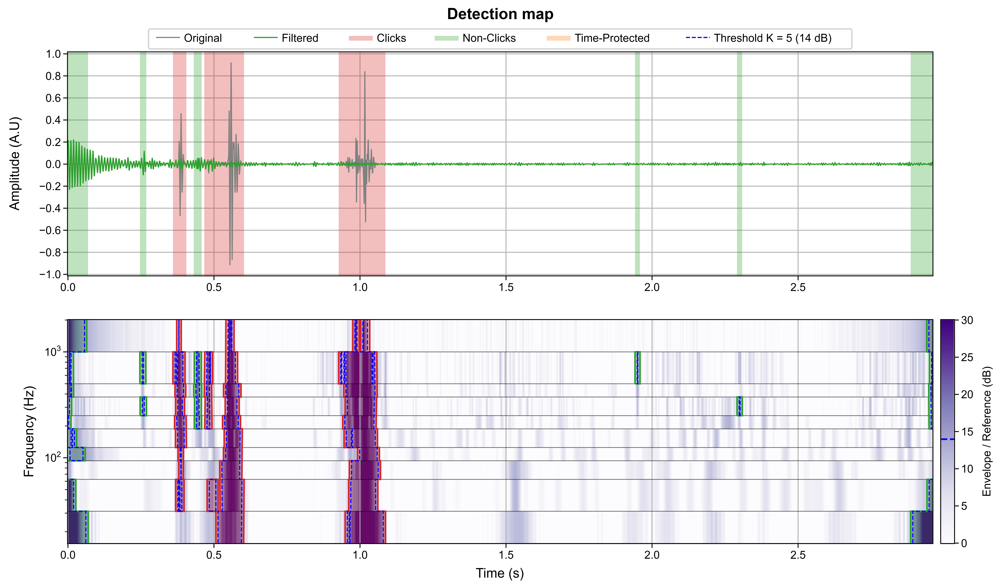
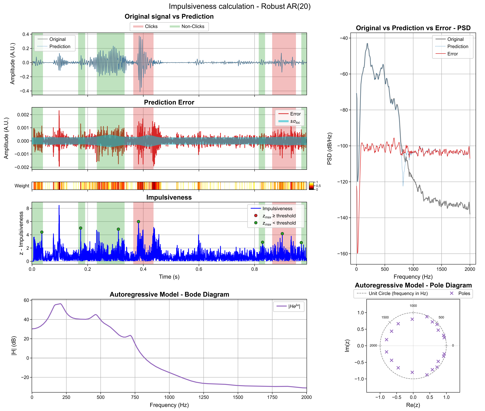
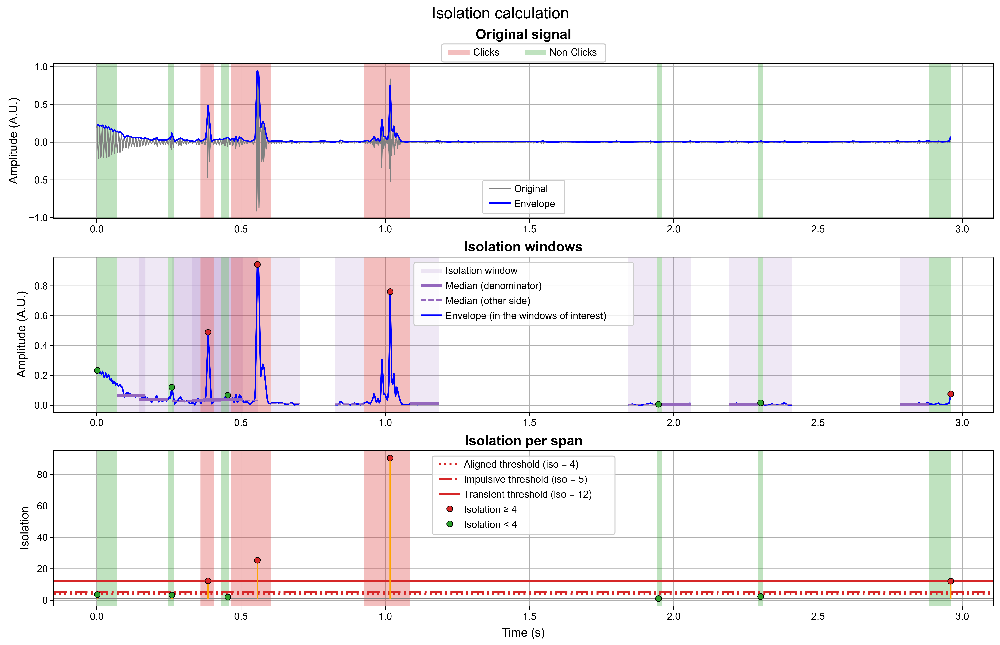
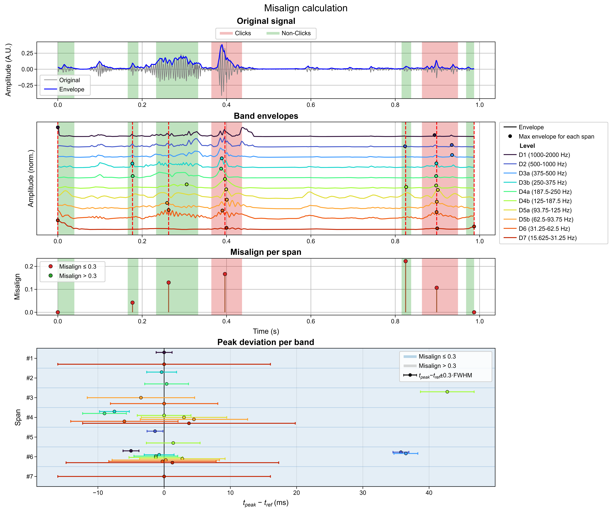
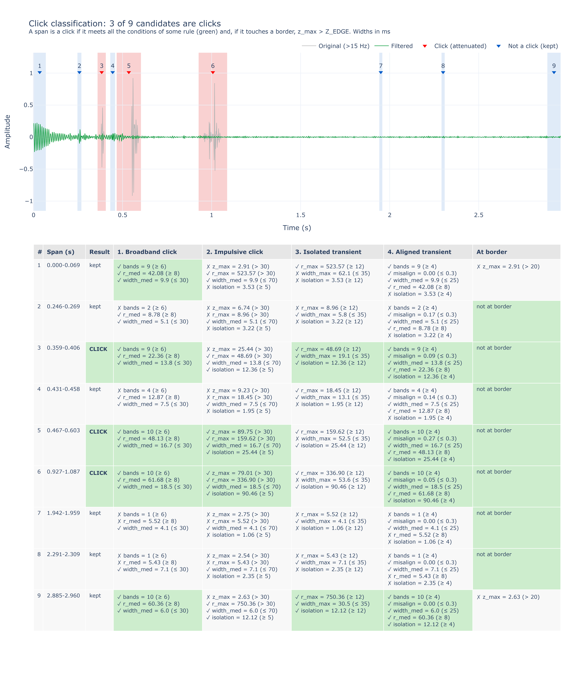
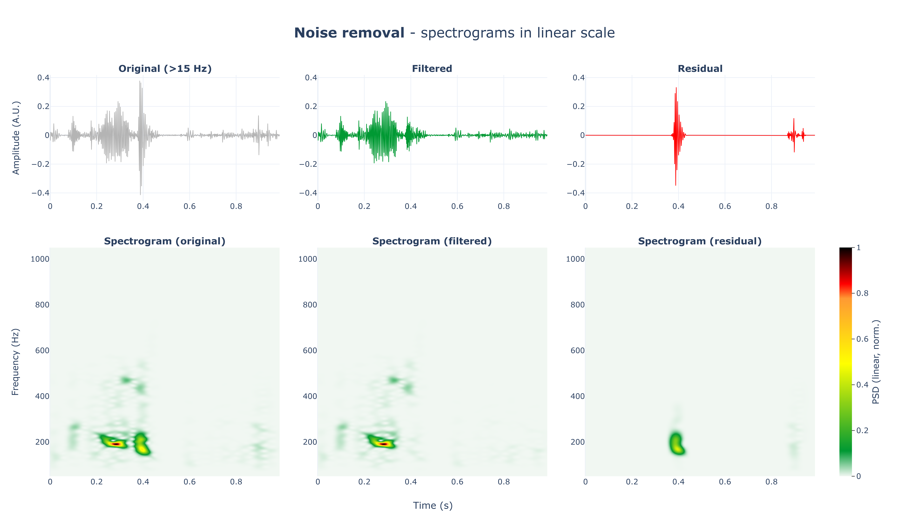
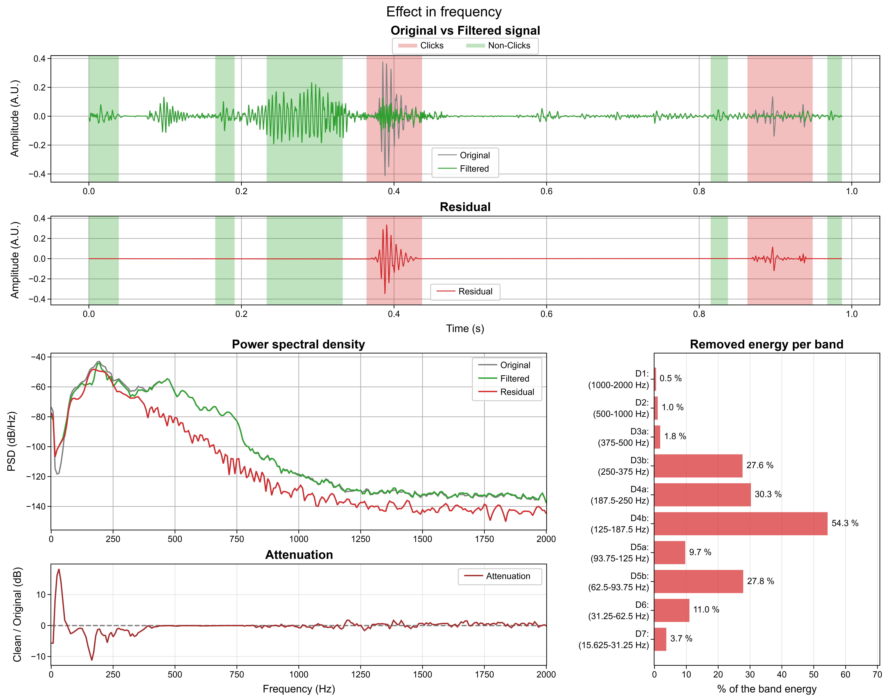

# 🧹 Denoising — Transient (Click) Removal Filter

This folder contains the development of the **transient removal filter** of the **EILO-BioAcoustics-Analysis** project: a pre-processing step that attenuates **clicks, crackles and other short broadband transients** in the respiratory sound fragments produced by the [📊 Dataset pipeline](../dataset/README.md).

- **Why:** some fragments contain impulsive noise (stethoscope friction, contact noise, saturation of the original recording, …) loud enough to **mask the respiratory sound, or to fake one**.
- **Goal:** remove those transients **without damaging** the respiratory, adventitious or heart sounds. When in doubt, the signal is kept.
- **Origin:** the filter is a modification of `soundwaveletSWT`, an adaptive wavelet filter originally designed to attenuate heart sounds (inspired by [Zhan et al., 2010](https://doi.org/10.1016/j.jelekin.2009.07.007)). Heart sounds are **no longer a target**: they are present in every class, `Normal` included.

> ⚠️ The thresholds of the algorithm have been **selected by eye** (visual and listening inspection of real fragments), **pending a deeper optimization**.

> ⚠️ The current version is **not yet ported to the dataset pipeline**: `dataset/src/remove_heart_sounds.py` (used by `dataset/get_rtf.py`) still implements a previous version (see [📋 Status](#-status)).

---

## Table of Contents

- [📂 Repository layout](#-repository-layout)
- [⚙️ Quickstart](#️-quickstart)
- [🔁 Algorithm overview](#-algorithm-overview)
    - [1️⃣ Decomposition into 10 bands](#1️⃣-decomposition-into-10-bands)
    - [2️⃣ Band signals (MRA)](#2️⃣-band-signals-mra)
    - [3️⃣ Detection per band](#3️⃣-detection-per-band)
    - [4️⃣ Long-event protection](#4️⃣-long-event-protection)
    - [5️⃣ Candidate features](#5️⃣-candidate-features)
    - [6️⃣ Click rules](#6️⃣-click-rules)
    - [7️⃣ Attenuation and reconstruction](#7️⃣-attenuation-and-reconstruction)
    - [⚙️ Parameters](#️-parameters)
    - [⚠️ Known limitations](#️-known-limitations)
- [🖼️ Example](#️-example)
- [📓 Notebooks](#-notebooks)
    - [▶️ How to run](#️-how-to-run)
    - [denoise_soundwaveletSWT.ipynb — Transient removal filter](#denoise_soundwaveletswtipynb--transient-removal-filter)
    - [denoise_summary_plots.ipynb — Development of the summary figures](#denoise_summary_plotsipynb--development-of-the-summary-figures)
    - [evaluation_denoise.ipynb — Evaluation of the algorithm](#evaluation_denoiseipynb--evaluation-of-the-algorithm)
- [📈 Summary figures — summary_plots.py](#-summary-figures--summary_plotspy)
- [📋 Status](#-status)

---

## 📂 Repository layout

```
denoising/
├── assets/                        ← summary figures of the example fragment (used in this file)
├── audio/                         ← the 78 fragments of evaluation_denoise.ipynb (38 clean signals + 40 artifact sources)
├── README.md                      ← this file
├── __init__.py
├── denoise_soundwaveletSWT.ipynb  ← original filter + current version of the algorithm + example
├── denoise_summary_plots.ipynb    ← development of the interactive (Plotly) summary figures
├── evaluation_denoise.ipynb       ← evaluation experiments of the algorithm (in progress)
├── run_experiments.py             ← runs experiment 1 or 2 of evaluation_denoise.ipynb from the terminal
├── src/                           ← importable modules (used by the notebooks)
│   ├── __init__.py
│   ├── evaluation.py              ← mixtures, metrics and parallel execution of experiments 1 and 2 (used by evaluation_denoise.ipynb)
│   ├── remove_noise.py            ← the algorithm, as a module (same code as the Funciones cell; used by evaluation.py)
│   └── summary_plots.py           ← the summary figures, as a module (used by denoise_soundwaveletSWT.ipynb)
└── results/                       ← metrics of each experiment (experiment_1.csv, experiment_2.csv)
```

The notebooks import the modules as a package from the `denoising/` folder (e.g. `from src import remove_noise as rn`, `from src.summary_plots import summary_plots`), so they must be run with `denoising/` as the working directory.

The notebooks read the fragments produced by step 4 of the [📊 Dataset pipeline](../dataset/README.md#4️⃣-extract-annotated-respiratory-fragments--get_fragmentspy) (`dataset/dataset/audio/{id}.wav`, 4 kHz). The exception is the evaluation (`evaluation_denoise.ipynb`, except its *Example* section): its clean signals and artifacts are read from `denoising/audio/`, an identical copy of those 78 fragments that is tracked by git (exception to `*.wav` in `.gitignore`), so the experiments can be reproduced without regenerating the dataset.

---

## ⚙️ Quickstart

The algorithm is the module [src/remove_noise.py](src/remove_noise.py) and its summary figures are in [src/summary_plots.py](src/summary_plots.py). From the `denoising/` folder (working directory):

```python
import soundfile as sf

from src import remove_noise as rn
from src.summary_plots import summary_plots

signal, fs = sf.read(rf"..\dataset\dataset\audio\{file}.wav")  # file: fragment id

# Filtered signal only (same length as signal)
clean = rn.remove_noise(signal, fs)

# Filtered signal + intermediate results
clean, details = rn.remove_noise(signal, fs, return_details=True)

# Summary figures: they need some constants of the algorithm (params); save_dir -> also saved as .png
PARAMS = dict(G_FAC=rn.G_FAC, K=rn.K, Z_CLICK=rn.Z_CLICK, Z_TOLERANCE=rn.Z_TOLERANCE, AR_ORDER=rn.AR_ORDER,
              ISO_WIN=rn.ISO_WIN, ISOLATION=rn.ISOLATION, ISOLATION_IMPULSIVE=rn.ISOLATION_IMPULSIVE,
              ISOLATION_ALIGNED=rn.ISOLATION_ALIGNED, MAX_MISALIGN=rn.MAX_MISALIGN)
summary_plots(signal, fs, details, PARAMS, save_dir="assets", scale=5)
```

- The parameters of the algorithm are module constants ([⚙️ Parameters](#️-parameters)): to change one, set it on the module before calling `remove_noise`, e.g. `rn.K = 6`.
- The **Funciones** cell of [denoise_soundwaveletSWT.ipynb](#denoise_soundwaveletswtipynb--transient-removal-filter) holds a copy of the same code, to read the algorithm step by step next to the original filter; [evaluation_denoise.ipynb](#evaluation_denoiseipynb--evaluation-of-the-algorithm) and [run_experiments.py](run_experiments.py) use the module.

---

## 🔁 Algorithm overview

`remove_noise(signal, fs)` works in 7 steps:

| Step | What it does | Output |
|:----:|:-------------|:-------|
| **1** | SWT (`db4`) + split of 3 levels | 10 frequency bands |
| **2** | Reconstruction of each band alone (MRA) | Time-domain signal of each band |
| **3** | Envelope vs. local reference (`K` times) | Detection mask per band |
| **4** | Long events (> 140 ms) are kept | Mask without respiratory/adventitious sounds |
| **5** | Union of the bands → candidate spans, 8 features each | Candidates |
| **6** | 4 click rules + border rule | Click spans |
| **7** | Gain < 1 inside the clicks, sum of the bands | Filtered signal |

Before step 1, only the first channel is used and its mean is removed. The signal is padded at the end (mirror) up to a multiple of 2⁸ samples, as required by the SWT, and cropped back at the end.

---

### 1️⃣ Decomposition into 10 bands

1. **SWT:** the signal is decomposed with the **Stationary Wavelet Transform** (`db4`) until the approximation is below ~15 Hz (`F_APPROX`). At 4 kHz, this gives **7 detail levels** (one octave each).
2. **Band splitting:** levels 3, 4 and 5 (62–500 Hz, `SPLIT_LEVELS`) are split into 2 half-bands with one more SWT step on the detail coefficients, using the filters dilated to that level (*stationary wavelet packet*).
3. The result is **10 bands**, ordered from high to low frequency:

| Band | Frequency (Hz) | FWHM (ms) | 
|:----:|:--------------:|:---------:|
| D1  | 1000–2000 | 4.0  | 
| D2  | 500–1000  | 4.0  | 
| D3a | 375–500   | 6.0  | 
| D3b | 250–375   | 7.5  | 
| D4a | 188–250   | 11.0 | 
| D4b | 125–188 | 13.5 |
| D5a | 94–125  | 21.5 |
| D5b | 62–94   | 27.0 |
| D6  | 31–62   | 27.0 |
| D7  | 16–31   | 53.5 |

> **FWHM** = Time resolution of each band: Full Width at Half Maximum of the envelope of its response to a unit impulse (`band_resolution`). It is the narrowest an event can look in that band.

> The approximation (< 15 Hz) is discarded: the output has no component below 15 Hz.

### 2️⃣ Band signals (MRA)

Each band is reconstructed **alone** (the coefficients of the rest set to 0): this is a **multiresolution analysis** (MRA, `band_signals`).

- Each band signal is the output of a **zero-phase** filter (analysis followed by its adjoint), so an event appears at the **same instant in every band** (no delay between bands).
- By linearity, the sum of the 10 band signals is exactly the original signal (> 15 Hz).
- Every following step (envelope, gain) works on these band signals, so the filtered signal only changes **where some gain is < 1**.

### 3️⃣ Detection per band

For each band:

1. **Envelope:** magnitude of the analytic signal (Hilbert), smoothed with a 4 ms moving average (`ENV_SMOOTH`).
2. **Local reference:** median of the envelope between **0.1 and 0.4 s at each side** of every sample (`REF_INNER`, `REF_OUTER`). The central ±0.1 s are excluded so the event does not raise its own reference. It is computed every 5 ms and interpolated (`REF_STEP`).
3. **Detection:** where the envelope exceeds **`K = 5` times the reference** (~14 dB), an event is detected. The mask is widened with a 15 ms window (`MASK_DILATION`).

> Very short fragments (< ~0.2 s) can have no reference at all: no detection there.

### 4️⃣ Long-event protection

Clicks, crackles and S1/S2 are short; respiratory and adventitious sounds (wheezes, stridor, rhonchi) are long.

- A detected event **longer than 140 ms** (`MAX_EVENT`) in a band is a respiratory/adventitious sound: it is removed from the mask (kept in the signal).
- The protection only applies to the **band where the long event is detected** (`PROTECT_LEVELS = 0`). In the low bands, the long SWT filters merge close, short impulses into one "long" event; protecting it in all bands would keep those impulses everywhere.
- Border protection is disabled (`EDGE = 0`): the borders are handled by the border rule of step 6.

### 5️⃣ Candidate features

The time spans where **some band** still has a detection (union over the bands) are the **candidates**. For each one, these features are measured (`find_click_events`):

- **`bands`** — number of bands with a detection in the span.
- **`r_med` / `r_max`** — intensity (envelope / reference): median over the detected bands of the maximum in the span / maximum over all the bands.
- **`width_med` / `width_max`** — **effective width** of the event, median / maximum over the detected bands (`effective_width`):
    - Area / height of the band envelope above a floor, scaled to the FWHM of a Gaussian (÷ 1.0645).
    - Floor = the larger of 2 × the median reference (`BG_FACTOR`) and the peak − 20 dB (`WIDTH_FLOOR_DB`).
    - Measured on the span extended 2 FWHM of the band at each side (`EXTEND`): the span is set by the threshold, the width by the event.
    - Unlike the time above the threshold, it does not grow with the intensity of the event. It includes the time resolution of each band.
- **`misalign`** — alignment of the band peaks: median over the detected bands of |t_peak − t_ref| / FWHM of the band (t_ref = median of the peak times).
    - A click is a singularity: its maxima are aligned across scales (`misalign` ≈ 0).
    - A respiratory or adventitious sound builds up and decays at different times in different bands (`misalign` ~0.3–1).
- **`z_max`** — maximum **impulsiveness** in the span (±10 ms, `Z_TOLERANCE`):
    - A robust **AR(20)** model of the whole fragment (Huber M-estimator, IRLS) predicts each sample from the previous ones (AR click detector of Godsill & Rayner).
    - `z` = |prediction error| / local robust scale of the error (0.1 s window, `Z_WIN`).
    - Respiratory, heart and tonal adventitious sounds are predictable (low `z`); the onset of a click is not.
- **`isolation`** — peak of the full-band envelope in the span / the larger of its medians in the **0.1 s before and after** (`ISO_WIN`).
    - The onset of a wheeze or a stridor only stands out over what comes before it.
    - A click or a crackle stands out over **both** sides.

### 6️⃣ Click rules

A candidate is a **click** (to be attenuated) if it meets **all the conditions of any** of these rules:

| Rule | Target | Conditions |
|:-----|:-------|:-----------|
| **1. Broadband click** | Strong, narrow click in most bands | `bands` ≥ 6 · `r_med` ≥ 8 · `width_med` ≤ 30 ms |
| **2. Impulsive click** | Very impulsive click, in few bands | `z_max` > 30 · `r_max` > 30 · `width_med` ≤ 70 ms · `isolation` ≥ 5 |
| **3. Isolated transient** | Crackles, even in a single band | `r_max` ≥ 12 · `width_max` ≤ 35 ms · `isolation` ≥ 12 |
| **4. Aligned transient** | Thumps, short scrapes, low-band clicks | `bands` ≥ 4 · `misalign` ≤ 0.3 · `width_med` ≤ 25 ms · `r_med` ≥ 8 · `isolation` ≥ 4 |

**Border rule:** a candidate closer than 10 ms to a border of the fragment (`EDGE_CLICK`) is only a click if also `z_max` > 20 (`Z_EDGE`), since its real duration is unknown (e.g. an adventitious sound cut by the annotation).

All the other candidates (heart sounds, bursts of adventitious sounds, breathing, …) are **kept**.

> No single feature works alone: after the 70–1900 Hz band-pass filter, many clear clicks have a low `z`, and bursts of wheeze, stridor and rhonchi are also broadband. The rules combine intensity, width, alignment, impulsiveness and isolation.

> Crackles are removed on purpose: the target classes of the project are the continuous adventitious sounds (in SPRSound this also removes the crackle part of `Wheeze+Crackle`, see [dataset step 6](../dataset/README.md#6️⃣-filter-fragments-by-label-and-duration--filter_datasetpy)).

### 7️⃣ Attenuation and reconstruction

1. **Where:** inside each click span, only the samples **detected in each band** (mask after the long-event protection). A protected long event is never attenuated, not even under a click.
2. **Reference:** the **immediate background** — median envelope in the 50 ms before and after the click (`LOCAL_BG`), if lower than the 0.1–0.4 s reference (which can include a nearby loud sound).
3. **Gain:** the band envelope is brought down to **`G_FAC = 1.5` times** that reference: gain = min(1, `G_FAC` · reference / envelope). Gain = 1 everywhere else.
4. **Smoothing:** the gain is smoothed with a 5 ms moving average (`GAIN_SMOOTH`); an abrupt gain step leaves audible tics.
5. **Reconstruction:** filtered signal = Σ (gain × band signal) over the 10 bands. Same length as the input, without the < 15 Hz component.

> `K` decides **where** to act, `G_FAC` **how much** to attenuate: `G_FAC = 0` leaves gaps, `1` leaves the event at the background median, `1.5` approximately at the respiratory sound level, `K` almost does not attenuate.

### ⚙️ Parameters

All the thresholds have been **selected by eye**, pending a deeper optimization.

| Group | Parameter | Value | Role |
|:------|:----------|:------|:-----|
| Decomposition | `WAVELET` / `F_APPROX` | `db4` / 15 Hz | Wavelet and lower limit of the decomposition |
| | `SPLIT_LEVELS` | [3, 4, 5] | Levels split into 2 half-bands (`None` → 7 bands) |
| Detection | `K` | 5 | Detection threshold (times the reference) |
| | `REF_INNER` / `REF_OUTER` | 0.1 / 0.4 s | Reference window at each side of the sample |
| | `REF_STEP` | 5 ms | Reference computed every 5 ms and interpolated (`None` → every sample) |
| | `ENV_SMOOTH` / `MASK_DILATION` | 4 / 15 ms | Envelope smoothing / mask widening |
| Protection | `MAX_EVENT` | 0.14 s | Longer events are kept (`None` → no protection) |
| | `PROTECT_LEVELS` | 0 | A long event in band *b* protects bands *b* ± `PROTECT_LEVELS` (`None` → all) |
| | `EDGE` / `PROTECT_MARGIN` | 0 / 0 s | Border protection and widening of the protected zones (disabled) |
| Width | `BG_FACTOR` / `WIDTH_FLOOR_DB` / `EXTEND` | 2 / 20 dB / 2 FWHM | Floor and window of the effective width |
| Rule 1 | `MIN_BANDS` / `R_MED` / `MAX_WIDTH` | 6 / 8 / 30 ms | Broadband click |
| Rule 2 | `Z_CLICK` / `R_CLICK` / `MAX_WIDTH_IMPULSIVE` / `ISOLATION_IMPULSIVE` | 30 / 30 / 70 ms / 5 | Impulsive click |
| Rule 3 | `R_TRANSIENT` / `MAX_WIDTH_TRANSIENT` / `ISOLATION` / `ISO_WIN` | 12 / 35 ms / 12 / 0.1 s | Isolated transient |
| Rule 4 | `MIN_BANDS_FEW` / `MAX_MISALIGN` / `MAX_WIDTH_ALIGNED` / `R_MED_ALIGNED` / `ISOLATION_ALIGNED` | 4 / 0.3 / 25 ms / 8 / 4 | Aligned transient |
| Border | `EDGE_CLICK` / `Z_EDGE` | 10 ms / 20 | Border candidates also need `z_max` > `Z_EDGE` |
| Impulsiveness | `AR_ORDER` / `HUBER_C` / `HUBER_ITER` | 20 / 1.345 / 10 | Robust AR model |
| | `Z_WIN` / `Z_STEP` / `Z_TOLERANCE` | 0.1 s / 5 ms / 10 ms | Local scale of the prediction error; tolerance around the span |
| Attenuation | `G_FAC` | 1.5 | Attenuation level (times the reference) |
| | `LOCAL_BG` / `GAIN_SMOOTH` | 50 / 5 ms | Immediate background / gain smoothing |

### ⚠️ Known limitations

- A click **inside a long sound** (e.g. within a stridor) is protected by step 4.
- **Weak** clicks and crackles (little above their band background, or not isolated) are missed.
- Long scrapes and weak low-frequency thumps are usually missed.
- Transients at the **borders** of the fragment are only removed if they are very impulsive (`z_max` > 20).
- The rules were tuned by eye on a limited set of real fragments: a missed noise is accepted as long as it does not mask the respiratory sound.

---

## 🖼️ Example

Summary figures of the filter applied to a fragment of the dataset, generated with [denoise_soundwaveletSWT.ipynb](#denoise_soundwaveletswtipynb--transient-removal-filter). In all the figures, **red** spans are clicks (attenuated) and **green** spans are candidates that are not clicks (kept).

### Decomposition summary

Top: original signal. Middle, one row per band: band signal (gray) and filtered (green) with its envelope (blue) and threshold `K` × reference (red); gain applied; component removed in the band. Bottom: filtered signal and removed component.


### Detection map

Top: original and filtered signal with the candidate spans. Bottom: envelope / reference (dB) of each band in time (log frequency axis), with the contours of the detections: red = attenuated (click), green = kept (not a click), orange = protected long event, dashed blue = threshold `K`.



### Impulsiveness

Robust AR(20) model: signal vs. prediction, prediction error with its local scale, Huber weights of each sample (dark = down-weighted, e.g. clicks), impulsiveness `z` with `z_max` of each candidate and `Z_CLICK`. Right / bottom: PSD of signal, prediction and error; frequency response and poles of the AR model.



### Isolation

Full-band envelope, the isolation windows (0.1 s before and after each candidate) with their medians, and the `isolation` of each candidate with the thresholds of rules 2, 3 and 4.



### Misalign

Normalized envelope of each band with its peak in each candidate (B), `misalign` of each candidate (C) and deviation of the peak of each band from t_ref with the tolerance ±0.3 FWHM (D). The clicks have their peaks aligned in almost every band.



### Click classification

Table with every condition of every rule for each candidate (✓/✗, value and threshold; green = rule met). In the notebook, hovering over the number of a candidate shows the same conditions.



### Noise removal

Original (> 15 Hz), filtered signal and residual (removed component), each with its spectrogram (linear power, same STFT range as the RTFs, 50–1050 Hz). The residual is normalized to the maximum of the original, so its colors show how much was removed.



### Effect in frequency

Original vs. filtered signal and residual (top), PSD of the three signals and attenuation (filtered / original, dB), and removed energy per band (% of the energy of each band). In this example the clicks hold most of the energy of the 31–1000 Hz bands.



---

## 📓 Notebooks

The notebooks are **development and documentation** tools: running them does not modify the dataset pipeline outputs.

### ▶️ How to run

From the `denoising/` folder, launch Jupyter / VS Code and open the notebook of interest, then run all cells in order (after editing a notebook, restart the kernel before running it again). The fragments must exist in `dataset/dataset/audio/` (step 4 of the [📊 Dataset pipeline](../dataset/README.md)); the experiments of `evaluation_denoise.ipynb` only need `denoising/audio/`.

The experiments can also be run **from the terminal** (e.g. on a remote machine, without Jupyter) with [run_experiments.py](run_experiments.py), from any folder (e.g. the repository root):

```bash
python denoising/run_experiments.py -e 1        # Experiment 1: single artifact
python denoising/run_experiments.py -e 2        # Experiment 2: several artifacts + idempotence
python denoising/run_experiments.py -e 2 -p 4   # -p, --processes: worker processes (default: as many as CPU cores)
```

- The script holds the same constants, signal selection and mixture generation (`get_mixes_1`, `get_mixes_2`) as sections 4, 5.1 and 6.1 of the notebook (identical mixtures), and calls `run_experiment`. If a constant is changed in the notebook, it must also be changed in the script.
- The algorithm runs with the default constants of [remove_noise.py](src/remove_noise.py).
- Notebook and script write to the **same file**, `denoising/results/experiment_{1, 2}.csv` (`RESULTS_DIR` of [evaluation.py](src/evaluation.py) is relative to the module, not to the working directory), so the results of the script can be loaded in the notebook with `read_results`. Running an experiment overwrites its previous `.csv`.

### [denoise_soundwaveletSWT.ipynb](denoise_soundwaveletSWT.ipynb) — Transient removal filter

Reference notebook of the filter, in 4 sections:

1. **Código original:** Python version of `soundwaveletSWT.m` (heart sound attenuator), with the same variable names as the MATLAB code for a line-by-line comparison.
2. **Adaptación al proyecto:** description of the changes with respect to the original (in Spanish).
3. **Funciones:** the current version of the algorithm (`remove_noise` and its helper functions), with all the parameters as constants at the top.
4. **Visualización + Ejemplo:** imports `summary_plots` from [summary_plots.py](#-summary-figures--summary_plotspy), runs the filter on an example fragment and shows the 8 summary figures, saving them as `.png` in `assets/`. These are the images of [🖼️ Example](#️-example).

### [denoise_summary_plots.ipynb](denoise_summary_plots.ipynb) — Development of the summary figures

Notebook where the current version of the algorithm and its figures were developed:

- **Cells 0–2:** imports, the algorithm (same version as the **Funciones** cell of `denoise_soundwaveletSWT.ipynb`, identical output) and the fragment to analyze.
- **Cells 3–10:** one figure per cell, each one defined and shown in the same cell: decomposition summary, detection map, impulsiveness, isolation, misalign, click classification, noise removal and effect in frequency.
- Most figures are **interactive Plotly reproductions** of matplotlib figures (same layout, sizes, fonts and legends), with linked time axes, legends that toggle series and hover information.

The figure functions were then copied to [summary_plots.py](#-summary-figures--summary_plotspy).

### [evaluation_denoise.ipynb](evaluation_denoise.ipynb) — Evaluation of the algorithm

Notebook for the **evaluation** experiments of the algorithm: artifacts are added to clean signals, where the expected result is known, and the output of the filter is measured.

> 🚧 **In progress:** experiment 1 has been run and its five result figures (detection, elimination, conservation, amplitude and factor analysis) are done. Experiment 2 is designed and implemented, but its final version has not been run yet (no results nor figures).

1. **Algorithm:** imported from [remove_noise.py](src/remove_noise.py). Its parameters can be changed as module constants, e.g. `rn.K = 6`, before running an experiment.
2. **Example:** the filter and its summary figures on one fragment.
3. **Selection of signals:**
    - **Clean signals:** 38 fragments (10 `Normal`, 10 `Wheeze`, 10 `Rhonchi`, 8 `Stridor`), with only 1 fragment per patient and no audible or visible clicks, scrapes or impacts.
    - **Artifacts:** 40 clearly visible transients cut from other fragments, with at most 1 per patient, from patients not in the clean set.
4. **Experiment 1 — Insertion of a single artifact:**
    - **Mixtures:** each clean signal × each artifact (that fits in it), at `N_REPS = 5` random positions (at least 0.1 s from the borders) and at each local SNR of `SNR_LIST` = −30, −20, −10, −5, 0, 5, 10 and 20 dB. If the same position is drawn twice, the repeated mixture is dropped (`get_mixes`).
    - The current `results/experiment_1.csv` (~60 700 rows) was run with the whole `SNR_LIST`.
    - **Control:** each clean signal is also processed without any artifact (`art_id` = `snr_db` = `"Control"`). It shows what the filter does to a signal that has no artifacts.
    - **Mixture descriptors** (`insert_artifact`, in [evaluation.py](src/evaluation.py)): duration of the artifact, local relative power of the clean signal around it (±25 ms, dB relative to the whole fragment) and global SNR (clean fragment vs artifact energy).
    - **Metrics** (`metrics`, in [evaluation.py](src/evaluation.py)), with the clean signal (> 15 Hz) as reference:
        - *Detection:* whether a click was detected in the artifact zone (±25 ms), and the number of false clicks.
        - *Elimination:* SNR in the artifact zone before and after the filter, its improvement (ΔSNR), and `attenuated` (ΔSNR ≥ 3 dB).
        - *Conservation:* error (NMSE) outside the artifact zone.
        - *Amplitude:* error (%) of the maximum and mean of the moving RMS (30 ms), in the artifact zone (local) and in the whole fragment (global), before (mixture) and after (output) the filter.
    - **Execution:** `run_experiment` (in [evaluation.py](src/evaluation.py)) processes all the mixtures in parallel with `multiprocessing`, one process per CPU core. It saves the metrics in `results/experiment_1.csv`. Also from the terminal: `python denoising/run_experiments.py -e 1` (see [▶️ How to run](#️-how-to-run)).
    - **Results:** loaded from the `.csv`. Five figures (sections 5.4.1–5.4.5), each one a function of `results_df` (which is not modified):
        - `plot_detection` — *Detection:* (A) detection rate vs SNR per artifact and global, (B) by class of the clean signal, (C) false positives vs SNR and in the controls, and (D) SNR at 50 % detection per artifact with its 95 % CI (bootstrap over the clean signals).
        - `plot_elimination` — *Elimination:* (A) SNR out vs SNR in of the detected artifacts, attenuated / not attenuated (mean ± IQR), (B) ΔSNR distribution per SNR level (violins), (C) proportion of attenuated artifacts (ΔSNR ≥ 3 dB) and detection rate vs SNR, (D) net SNR improvement vs SNR (all the mixtures, undetected → ΔSNR = 0, and only the detected ones), and (E) SNR improvement of the detected artifacts by class of the clean signal.
        - `plot_conservation` — *Conservation:* (A) NMSE out of the artifact zone vs SNR (mean ± 95 % CI over the clean signals) and in the controls, (B) NMSE out of the zone vs number of detections out of the zone (false positives), mixtures and controls, (C) and (D) the same two by class of the clean signal, and (E) cumulative distribution of the NMSE out of the zone, with references at 1 % and 0.01 % of the signal power.
        - `plot_amplitude` — *Amplitude:* RMS error (%) before (mixture) and after (output) the filter vs SNR (median ± IQR), in 4 panels: maximum / mean RMS, local / global, with the controls in the global ones. Each panel has a zoom of the −7 to 22 dB range.
        - `plot_factor_analysis` — *Factor analysis:* what the result depends on. (A) detection rate and (B) mean ΔSNR of the detected artifacts per artifact and SNR (heatmaps), (C) SNR at 50 % detection vs duration of the artifact (with `MAX_EVENT`), (D) detection rate and (F) ΔSNR of the detected artifacts vs local relative power of the clean signal (deciles, per SNR), (E) local power vs global SNR of the detected and not detected mixtures (density), (G) error of the global RMS peak before / after vs global SNR, and (H) ΔSNR vs NMSE out of the zone of the detected artifacts (removal vs conservation).
        - Each one is defined twice: in matplotlib + `seaborn`, and right after as an interactive Plotly reproduction (same layout and sizes, hover information, legends that toggle series, zoom); running the cells in order leaves the Plotly one active.
5. **Experiment 2 — Insertion of several artifacts:** what changes when the artifacts are not alone (close artifacts, a strong one masking weak ones), and whether the filter is idempotent.
    - **Layouts:** for each clean signal, `N_GROUPS = 20` random triplets of distinct artifacts. For each triplet and each edge-to-edge gap of `GAP_LIST` = 25, 50, 100, 300 and 500 ms, the three artifacts are placed in random order, one after another with the same gap, at a random position of the signal (at least 0.1 s from the borders). A layout that does not fit is skipped.
    - **Paired subsets:** from each layout, every non-empty subset of its artifacts is mixed **at the same positions**: the 3 single artifacts, the 3 pairs and the triplet (7 mixtures, same `group_id`, `subset` = layout positions present). Each artifact can then be compared alone and accompanied, with everything else equal.
    - **SNR conditions** (local SNR of each artifact, as in experiment 1):
        - *Equal:* all the artifacts at the same SNR, for each SNR of `SNR_LIST` = −20, −10, −5, 0, 5, 10 and 20 dB.
        - *Unequal (masking):* one artifact of the layout, chosen at random, is strong (`SNR_STRONG` = −20 dB, `is_strong`) and the others are weak, at each SNR of `SNR_WEAK_LIST` = −10, −5 and 0 dB.
    - **Duplicates:** the same mixture (same artifacts, positions and SNRs, e.g. a single artifact of both conditions) is only kept once, with the first `group_id`.
    - **Control:** each clean signal without any artifact (`n_art` = 0, `art_ids` = `snr_db` = `"Control"`).
    - **Mixtures** (`insert_artifacts`, in [evaluation.py](src/evaluation.py)): each artifact is scaled with respect to the **clean** signal, as in experiment 1, so its scaling does not depend on the other artifacts; the mixture is the clean signal plus the contribution of every artifact. The descriptors of `insert_artifact` are kept per artifact.
    - **Metrics** (`metrics_multi`, in [evaluation.py](src/evaluation.py)):
        - *Artifact zones* (`artifact_zones`): ±25 ms around each artifact, as in experiment 1, but cut at the midpoint of the gap when two zones would overlap, so each sample belongs to one zone at most.
        - *Per artifact* (one value per artifact, in its own zone): detection, `merged` (its click span also touches the zone of another artifact), SNR in / out, ΔSNR, `attenuated` and local amplitude errors. The SNR is measured with the contribution of that artifact alone, without the others.
        - *Per mixture:* number of detected artifacts (`n_detected`, `all_detected`), false clicks (click spans that touch no artifact zone), NMSE out of all the zones, NMSE of the signal **between** consecutive artifacts (`nmse_between_db`: how much a merged span changes the signal between the clicks), global amplitude errors and global SNR of all the artifacts together (`snr_global_mix_db`).
        - *Idempotence:* every mixture (and control) is processed **twice**, f(f(x)). Number of clicks of the second pass (`n_clicks_pass2`, ideally 0), of them inside the artifact zones (`n_clicks_pass2_in_zones`) and change of the second pass (`idem_nmse_db`, NMSE of f(f(x)) − f(x)).
    - **Execution:** `run_experiment(..., worker=process_mixture_multi)` saves the metrics in `results/experiment_2.csv` (also from the terminal: `python denoising/run_experiments.py -e 2`). The per-artifact columns are tuples, saved as JSON lists; `read_results` reads them back as tuples.
    - **Results:** 🚧 pending. The final version of the experiment has not been run yet.

---

## 📈 Summary figures — [summary_plots.py](src/summary_plots.py)

Module with the figure functions of `denoise_summary_plots.ipynb`, built from the intermediate results of `remove_noise(..., return_details=True)`. `summary_plots(signal, fs, details, params, save_dir=None, scale=5)` shows them one after the other:

| Function | File (`save_dir`) | Content |
|:---------|:------------------|:--------|
| `decomposition_summary_plot` | `decomposition_summary.png` | Band signals, envelopes, thresholds, masks, gains and removed component |
| `plot_detection_map` | `detection_map.png` | Time–band map of envelope / reference with the masks |
| `plot_impulsiveness` | `impulsiveness.png` | Robust AR model, prediction error and impulsiveness `z` |
| `plot_isolation` | `isolation.png` | Isolation windows and `isolation` per candidate |
| `plot_misalign` | `misalign.png` | Band peaks and `misalign` per candidate |
| `plot_click_criteria` | `click_criteria.png` | Conditions of each rule per candidate |
| `plot_noise_removal` | `noise_removal.png` | Original, filtered and residual, with spectrograms |
| `plot_frequency_response` | `frequency_response.png` | PSD, attenuation and removed energy per band |

- `params`: the algorithm constants the figures need (`G_FAC`, `K`, `Z_CLICK`, `Z_TOLERANCE`, `AR_ORDER`, `ISO_WIN`, `ISOLATION`, `ISOLATION_IMPULSIVE`, `ISOLATION_ALIGNED`, `MAX_MISALIGN`).
- `save_dir`: if given, each figure is also saved as `<save_dir>/<name>.png` (Plotly static export with `kaleido`), with `scale` as the image scale factor.

> The FWHM of each band (`plot_misalign`, values of the table in [step 1](#1️⃣-decomposition-into-10-bands)) is computed with `band_resolution` of [remove_noise.py](src/remove_noise.py), for the decomposition of `details["bands"]`, so it follows any change of the decomposition.

---

## 📋 Status

- [x] Click-only transient removal (4 rules + border rule) developed and checked by eye and by ear on real fragments.
- [x] Summary figures (`summary_plots.py`) and example in `denoise_soundwaveletSWT.ipynb`.
- [ ] Evaluation of the algorithm (`evaluation_denoise.ipynb`):
    - [x] Experiment 1 (single artifact): run, with its result figures.
    - [ ] Experiment 2 (several artifacts + idempotence): designed and implemented, pending execution and figures.
- [ ] Deeper optimization of the thresholds (currently selected by eye).
- [ ] Port of the current version to the dataset pipeline (`dataset/src/remove_heart_sounds.py`, used by `dataset/get_rtf.py`, and `dataset/visualization_fragment.ipynb`).
